# Reiko's Train Mod

Big steam, diesel and electric trains for Minecraft **1.21.1** (NeoForge), on their own track, and trams in the
street. Lay a railway with curves, ramps and junctions, signal it, work its switches by hand or with redstone, name its
stations, load and unload freight automatically, and either drive the trains yourself (throttle, brake, whistle, a
choice of way at every junction) or give them a timetable and let them run between the stations on their own.

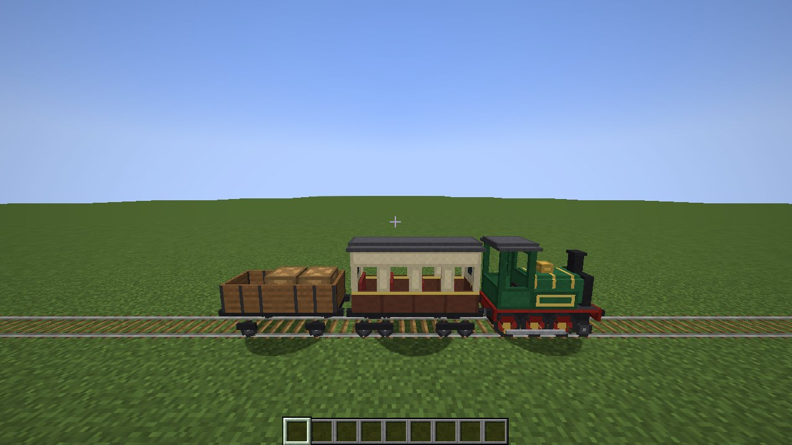

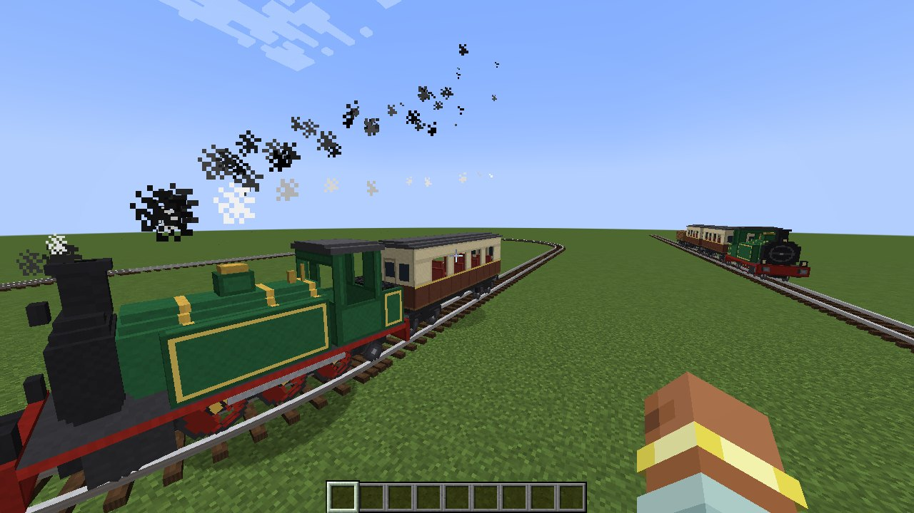

## Requirements

- Minecraft 1.21.1 with NeoForge 21.1.265 or newer
- [BuildCraft Reborn](https://github.com/Reiko45/BuildCraft-Reborn) 2.1.0 or newer: the diesel locomotive runs on
  its diesel, the same fuel as the diesel vehicles in [Reiko's Car Mod](https://github.com/Reiko45/Reiko-s-Car-Mod),
  and the electric locomotive on its power (MJ)
- Optional: [Xaero's Minimap](https://modrinth.com/mod/xaeros-minimap) 24 or newer (made with 26.6.0): trains show
  on it
- Optional: [Reiko's Car Mod](https://github.com/Reiko45/Reiko-s-Car-Mod) 1.39 or newer: car transporter wagons
  carry its cars
- Optional: [Patchouli](https://modrinth.com/mod/patchouli) (made with 1.21.1-93): the **Railway Handbook**, the
  mod's guide book
- Optional: [JEI](https://modrinth.com/mod/jei) 19 or newer (made with 19.21.2): an information page for each of the
  mod's items, and pages for what the locomotives run on and what the track-laying wagon fills dips with

## What's in it

- **Train Track**: its own railway, separate from minecart rails. Straight track goes down block by block (east-west,
  north-south or diagonal), and curves, ramps, S-bends and long straights are drawn from one track block to another.
  Two ways out of the same end of a block make a junction.
- **Street Track**: track set into the road, its grooved rails level with the top, so cars and people go over it.
  Street corners can be tighter than train track's.
- **Steam Locomotive**: a green tank engine, 2 blocks wide, 3 tall and 6 long. It burns coal (or charcoal, logs,
  blocks of coal, blaze rods, lava...) and needs water too, puffs smoke and chuffs, and its driving wheels and
  coupling rods turn as it goes. Seats a driver and a fireman.
- **Express Locomotive**: a crimson 4-6-0, 8 blocks long, with big driving wheels: a third faster than the tank
  engine and nearly twice as strong. It burns coal from its **Tender**, which holds four times as much.
- **Diesel Locomotive**: a blue road-switcher, 7 blocks long, on two bogies. It runs on BuildCraft's diesel (Dense
  Fuel), the same as the car mod's diesel trucks, and pulls harder than either steam engine.
- **Electric Locomotive**: a red box-cab electric, 7½ blocks long, with a cab at each end. It runs on BuildCraft
  power (MJ) from its batteries: the fastest and strongest engine, and nearly silent, but it needs charging often.
- **Vintage Tram**: a red and cream single-car tram with a platform and controller at each end, so it runs either
  way, and a trolley pole to the overhead wire.
- **Low-Floor Tram**: a modern three-section tram, white with a green band, that bends round street corners. One item
  puts all three sections on the track.
- **Bullet Train**: the top of the line. A white, blue-striped high-speed train with a long streamlined nose,
  about 100 km/h: a driving car at each end and **Bullet Train Coaches** between, so it runs both ways without
  turning. It runs on batteries, like the electric.
- **Water Tower**: a wooden tank on legs beside the track, for steam engines. Fill it with buckets or pipes, and it
  fills the tank engines and tenders of a train standing beside it.
- **Turntable**: digs its own pit, 15 blocks across, and turns locomotives round in it, or sends them off down
  whichever track you like. Trains on a timetable are turned round on it at the end of the line.
- **Engine Shed Doors**: a big pair of doors over the track for the end of an engine shed, which open for trains and
  shut behind them. Engines standing inside are topped up with coal, water, diesel or charge from their store.
- **Charging Point**: charges the batteries of an electric standing beside it, from BuildCraft engines, kinesis pipes
  or other mods' cables.
- **Overhead Line Mast**, **Overhead Wire** and **Substation**: electrify a line. Masts stand beside the track with
  their arms reaching over it; string wire from mast to mast; a substation feeds the line BuildCraft power. Electrics
  and the Bullet Train raise their pantographs under it and run (and charge) from the wire.
- **Passenger Coach**: 6½ blocks long, eight seats in four rows.
- **Freight Wagon**: holds 108 stacks (four chests' worth), all on one screen. Hoppers above or below it fill and empty
  it, crates pile up in it as it fills, and a full one is heavier to pull.
- **Tank Wagon**: carries 256 buckets of any fluid: water, lava, oil, BuildCraft's fuels. A gauge on its side shows
  how full it is.
- **Livestock Wagon**: six stalls for cows, sheep, pigs, horses or any other animal, with slatted sides to see them
  through. Lead animals to it, or have a wagon loader load them from a pen.
- **Car Transporter**: a long flatbed for the cars, vans and buses of Reiko's Car Mod. Drive them on at the end and
  off again, from wagon to wagon along the train.
- **Guard's Van**: for the back of the train. Two seats and a stove inside, tail lamps, and a brake that makes the
  whole train stop quicker.
- **Track-Laying Wagon**: push it off the end of the line and it lays track ahead of itself, straight on or round a
  bend as you steer, digging through hills and filling in dips to keep the line level.
- **Wagon Loader**: fills the freight wagons of a train standing beside it from the chests next to it, or empties
  them into the chests, all of it or (with its filter) just the items you choose.
- **Coupler**: joins cars into trains.
- **Railway Signal**: red while there's a train on the line ahead, green when it's clear. Trains stop for red.
- **Three-Light Signal**: red, yellow and green. Yellow while the next signal is red, so trains come up to it at
  caution speed, ready to stop.
- **Signal Box**: a desk with a lever frame. Its screen is a live map of the railway round it, trains and all: throw
  switches and hold signals at red from it.
- **Switch Stand**: sets which way trains go at a junction. Flip it by hand, or set and hold it with redstone.
- **Track Sensor**: gives a redstone signal while a train is over the track beside it: any train, or only trains
  going one way, with a certain kind of car, carrying something, or running a certain timetable.
- **Speed Limit Sign**: 10 to 50 km/h, or the end of a limit. Trains slow down in time for it and keep to it until
  the next sign.
- **Level Crossing**: where a road crosses the line, lamps that flash, a bell that rings and a barrier arm that comes
  down across the road while a train goes by. Cars from Reiko's Car Mod can't get through it.
- **Station**: a nameboard beside the track. Trains stop with their front level with it.
- **Timetable**: a list of stations for a train to run between by itself, leaving wagons at some and picking them up
  at others.
- **Railway Handbook** (with Patchouli): the guide to all of it, in the game.

The coaches and wagons ride on two bogies that swing under them, so long cars go round curves like the real thing.

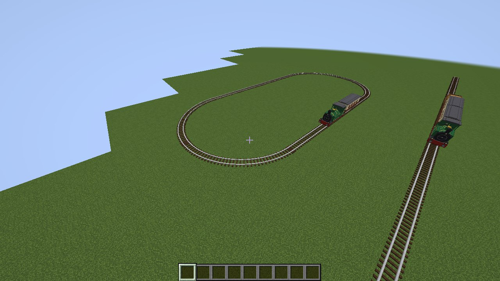

## The Railway Handbook

With [Patchouli](https://modrinth.com/mod/patchouli) installed, the mod has a guide book: the **Railway Handbook**.
Every player is given one the first time they join a world (once ever; a server can turn that off with
`giveHandbook`), and another can be crafted from a book and a piece of Train Track.

- A chapter for each part of the mod: getting started, track, driving, the locomotives, coaches and wagons, engine
  depots, wires and trams, signalling, stations and timetables, freight, and settings. Every recipe is on the page
  about what it makes, the locomotives and wagons turn on stands, and there are pictures from the game.
- The mod's screens (the track-laying wagon, signal box, wagon loader, freight wagon and station) have a little book
  button in the corner: it opens the handbook at that screen's page.

With [JEI](https://modrinth.com/mod/jei) installed, every one of the mod's items has an **information** page saying
what it does, as well as its recipe, and there are two pages of its own:

- **Locomotive Fuel**: what the steam engines (coal and the like, grouped by how long they burn, and water), the diesel
  (each kind of diesel) and the electrics (charging points and overhead lines) run on, with how long each lasts at full
  throttle. Look up the uses of coal, or of a locomotive, to find it.
- **Track-Laying Wagon**: what it lays, and everything it fills dips with.

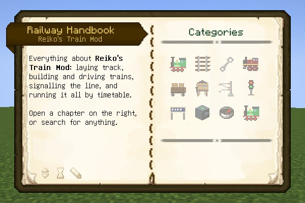

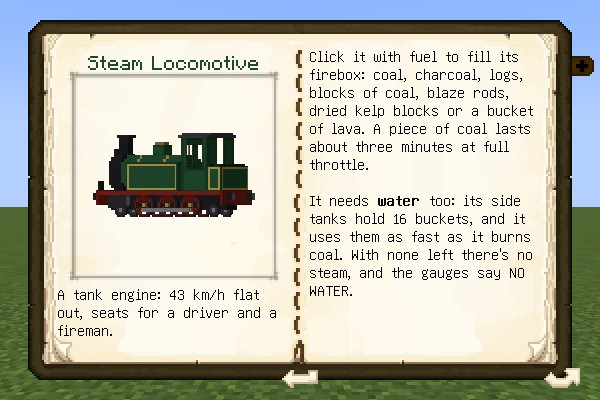

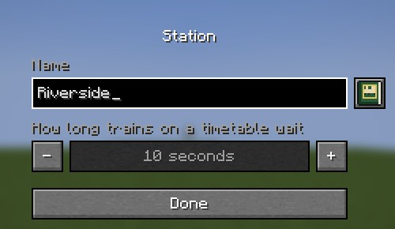

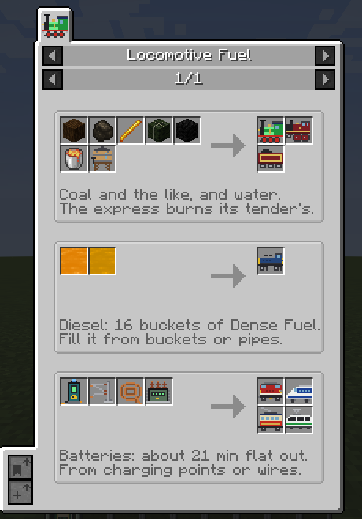

## Building a railway

| | |
| --- | --- |
| **Straight track** | Place Train Track on the ground: it runs the way you're facing (one of eight directions). Blocks in a line join up by themselves. |
| **Curves and ramps** | Hold track and click a track block to start from, then click where the line should go: on the ground for a new end (the track there faces to make a smooth curve), or on another track block to join it. A green outline shows the curve before you click (red if it can't be built, with the reason). |
| **S-bends** | Sneak while you click the end, and the track there faces the way you're looking. |
| **Junctions** | Draw a curve off a track block that already has track going on from the same end. |
| **Start over** | Sneak-click the air, or click the starting block again. |
| **Street track** | Set Street Track into the road like any block (in place of a road block), and draw curves between street track blocks with it the same way; click the top of a road block for a new end, and it's set into that block. |

A curve can reach 48 blocks, can't turn tighter than a radius of 5 blocks (8 or more looks best with long cars) or
more than 90° at once, and a ramp can't be steeper than about 1 in 2 at its steepest. Curves cost a piece of track
per block of length, and breaking either end gives it back. Track needs solid ground under its blocks, but a curve
or ramp can cross gaps between them, so bridges are just long curves. Leave three blocks between parallel lines.

Street track's rails are level with the top of its block, so a street running on into train track needs a ramp (any
curve between them is one). Curves between two street track blocks can be as tight as a radius of 3 blocks, for street
corners, and are paid for in street track; the road blocks a curve passes over are up to you.

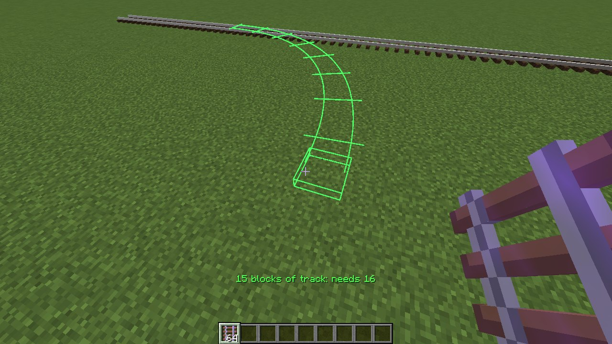

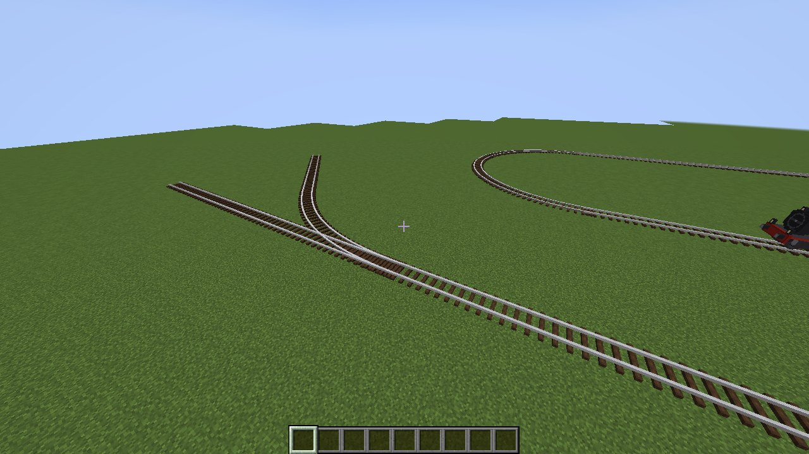

### The track-laying wagon

For a long line, let a train lay it. The **Track-Laying Wagon** is a yellow flat wagon with a gantry at one end and
panels of track stacked along it (as many as it has track for).

- **Load it**: click it for its store, 27 slots (hoppers and pipes reach it too). Put in Train Track, and something
  to fill dips with: stone, cobblestone, dirt or gravel (or deepslate, andesite, diorite, granite, tuff, calcite,
  sandstone, netherrack, blackstone and the like).
- **Lay track**: couple it at the **front** of a train, drive up to the end of the line and keep going. It lays track
  ahead of itself, a block at a time, from the end of it with nothing coupled on, and holds the train to a fast walk
  (about 11 km/h) while it works. Stop, or back away, and it stops laying.
- **Straight on, or a bend**: it carries the line straight on the way its last block runs, diagonals too. Steer left
  or right (the same keys as at a junction) and it lays a smooth **45° bend** that way instead, about ten blocks
  across, then goes straight on again. One bend for each press: press again after it for a right angle.
- **A level line**: it never climbs or drops. A hill in the way, it digs a cutting through: three blocks wide and four
  high, and sand or gravel over it comes out too so nothing falls in. What it digs goes in its store (stone comes out
  as cobblestone; anything that won't fit falls out beside it), so one cutting fills the next dip. A dip up to six
  blocks deep is filled in under the track.
- **Where it stops**: when it's out of track or fill, at **water or lava** (in the way or under the line), at a drop
  too deep to fill (lay a bridge by hand and carry on from its far end), and at bedrock, a chest or anything else
  with things in it, or other track, right in the way. Its screen says why, and so does a message to the driver.
  Blocks beside the line that it won't dig, it leaves be.
- The **switch** in its screen turns it off: then it's an ordinary wagon, and lays nothing.

It lays train track from train track; it doesn't lay street track, or off a turntable.

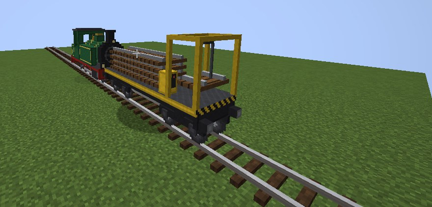

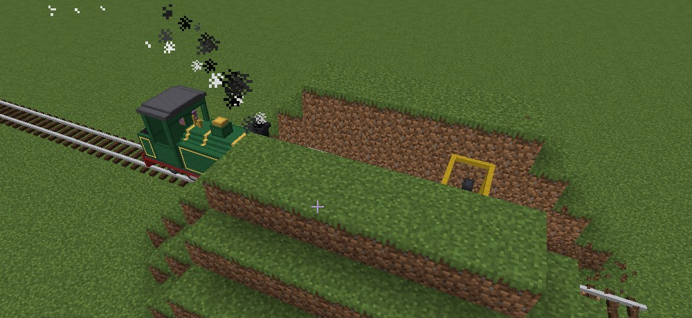

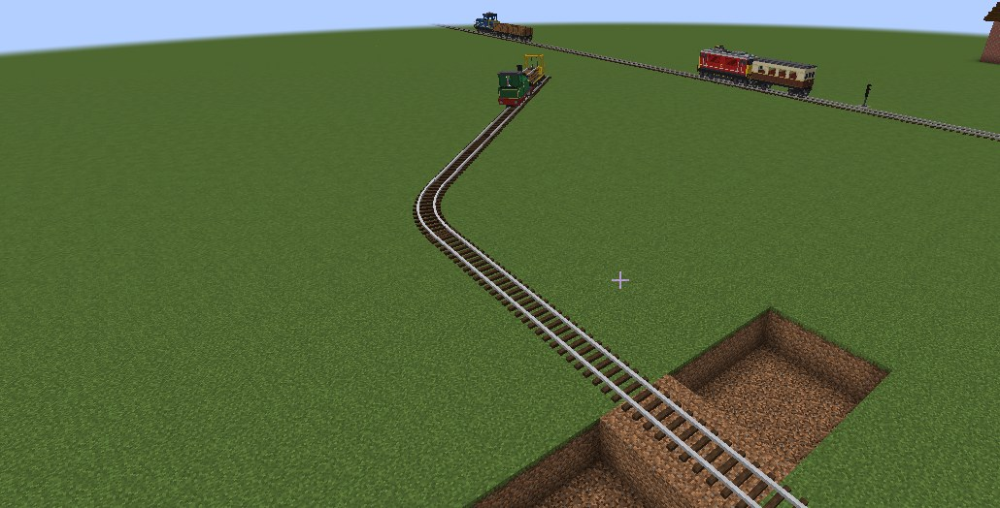

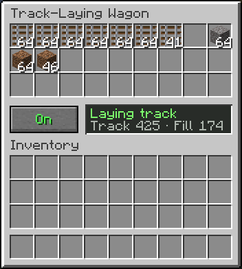

## Trains

### Crafting

| Item | Recipe |
| --- | --- |
| Train Track (16) | Iron ingots in the four corners, a row of wooden slabs across the middle |
| Steam Locomotive | Furnace minecart in the middle, copper ingots either side, iron ingots along the bottom and one top right (the chimney) |
| Express Locomotive | Copper, gold, copper; iron ingot, steam locomotive, iron ingot; three iron ingots |
| Tender | Iron ingot, cauldron, iron ingot; iron ingot, minecart, iron ingot |
| Diesel Locomotive | Three iron ingots; iron ingot, blast furnace, iron ingot; copper ingot, minecart, copper ingot |
| Electric Locomotive | Three iron ingots; copper ingot, block of redstone, copper ingot; iron ingot, minecart, iron ingot |
| Bullet Train | Quartz block, glass, quartz block; diamond, electric locomotive, diamond; iron ingot, block of redstone, iron ingot |
| Bullet Train Coach | Three glass panes; quartz block, blue wool, quartz block; iron ingot, minecart, iron ingot |
| Passenger Coach | Glass panes on top; planks, wool, planks; iron ingot, minecart, iron ingot |
| Freight Wagon | Planks around a chest (top middle open); iron ingot, minecart, iron ingot |
| Tank Wagon | Three iron ingots; iron ingot, bucket, iron ingot; iron ingot, minecart, iron ingot |
| Livestock Wagon | Three planks; fence, hay bale, fence; iron ingot, minecart, iron ingot |
| Car Transporter | Chain, iron ingot, chain; iron ingot, minecart, iron ingot |
| Guard's Van | Planks, lantern, planks; planks, furnace, planks; iron ingot, minecart, iron ingot |
| Track-Laying Wagon | Iron ingot, chain, iron ingot; Train Track, iron pickaxe, Train Track; iron ingot, minecart, iron ingot |
| Coupler | Iron ingot, chain, iron ingot (a column) |
| Railway Signal (2) | Redstone lamp, iron ingot, iron ingot (a column) |
| Three-Light Signal | A Railway Signal, a redstone lamp and yellow dye (any shape) |
| Signal Box | Three levers; planks, an empty map, planks; three planks |
| Switch Stand | Lever, iron ingot, iron ingot (a column) |
| Station | Any sign, iron ingot, iron ingot (a column) |
| Track Sensor (2) | Observer, redstone, iron ingot (a column) |
| Speed Limit Sign (4) | Red dye, white dye, red dye; white dye, black dye, white dye; an iron ingot in the bottom middle |
| Level Crossing | Redstone lamps in the top corners; red dye, iron ingot, white dye; a bell in the bottom middle |
| Timetable | Two paper and a clock |
| Wagon Loader | Iron ingot, hopper, iron ingot; iron ingot, chest, iron ingot |
| Water Tower | Planks, iron ingot, planks; planks, cauldron, planks; logs in the bottom corners |
| Turntable | Three Train Track; block of iron, piston, block of iron; three stone bricks |
| Engine Shed Doors | Three logs; wooden door, hopper, wooden door; logs in the bottom corners |
| Charging Point | Iron ingot, redstone lamp, iron ingot; copper ingot, block of redstone, copper ingot; three iron ingots |
| Street Track (6) | Three Train Track; stone, coal, stone; three stone |
| Vintage Tram | Three glass panes; red wool, block of redstone, white wool; iron ingot, minecart, iron ingot |
| Low-Floor Tram | Three glass; white wool, block of redstone, green wool; minecart, iron ingot, minecart |
| Overhead Line Mast (2) | Three iron ingots along the top, an iron ingot under the left one, and smooth stone under that (a pole with its arm) |
| Overhead Wire (4) | Three copper ingots in a row |
| Substation | Block of copper, iron ingot, block of copper; iron ingot, block of redstone, iron ingot; three iron ingots |

Everything's also in the **Reiko's Trains** creative tab.

### Making up a train

1. Click a track block with a car to put it there, facing along the track the way you're looking. It needs track under
   both its bogies.
2. Take the **Coupler**, click one car, then the car next to it on the same line (up to 5 blocks between their
   buffers). The second car's train is drawn up until the buffers meet. Cars couple at either end, facing either way,
   and the locomotives can be anywhere in the train: they pull or push.
3. To uncouple a car, **sneak-click** it with the coupler.

A train can have up to 16 cars (configurable), and as many locomotives among them as you like (see
[More than one locomotive](#more-than-one-locomotive)).

### Driving

Click the locomotive with fuel to fill the firebox (it takes as much of the stack as fits), then click it with an
empty hand to climb into the cab.

| Key | Does |
| --- | --- |
| Forward (W) | Throttle up a notch (hold to keep going) |
| Back (S) | Throttle down a notch, through neutral into reverse |
| Jump (Space) | Brake, while held |
| Left / right (A / D) | Hold to take the left or right way at the next junction (otherwise it goes straight on). Junctions with a switch stand go the way the switch is set |
| H | Whistle, or the diesel's horn (rebind under Controls, *Reiko's Trains*) |
| Sneak | Get out |

The gauges, bottom right, show the next signal (and how far), the next switch (which way it's set, and how far), the
next station, the throttle notch (R2, R1, N, 1-4),
the speed and the speed limit, which way you're steering, the brake and the firebox (or tender, or fuel tank), and a
steam engine's water. Top speed is 43 km/h for the
tank engine, 52 km/h for the diesel, 58 km/h for the express, 60 km/h for the electric and 100 km/h for the Bullet Train; a heavy train takes longer to get going, and slows (or stalls) going uphill.
Cars roll downhill on their own. At the end of the line a train stops dead. If the track under a car is broken, the
car comes off and drops as an item. With nobody at the controls the handbrake holds the train, and the fire only
burns while someone's driving. A moving train keeps the chunks around it loaded, so it doesn't stop at the edge of
the loaded world, and it nudges people and animals off the line.

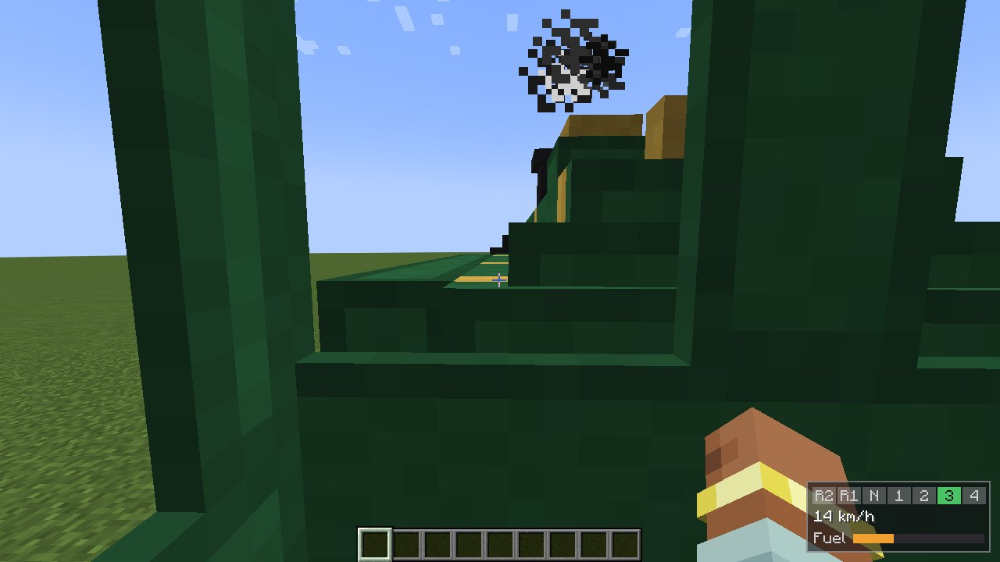

### The express and its tender

The **Express Locomotive** is the big engine: 8 blocks long, with six 1⅛-block driving wheels. It goes a third
faster than the tank engine (58 km/h), pulls nearly twice as hard, and burns coal faster. It carries no coal itself:
couple a **Tender** to it (at either end, usually behind the cab) and it burns the tender's. A tender holds 128 coal's
worth, four times a tank engine's firebox, and the coal heap in it goes down as it's used.

- Click the engine or the tender with fuel to fill the tender. Click the tender empty-handed to see how full it is.
- Hoppers and wagon loaders fill tenders too, with fuel only: a train on a timetable can take on coal at a station
  with a loader (the tender takes fuel first; anything else goes on into the wagons).
- Without a tender the express won't go, and its gauges say NO TENDER.

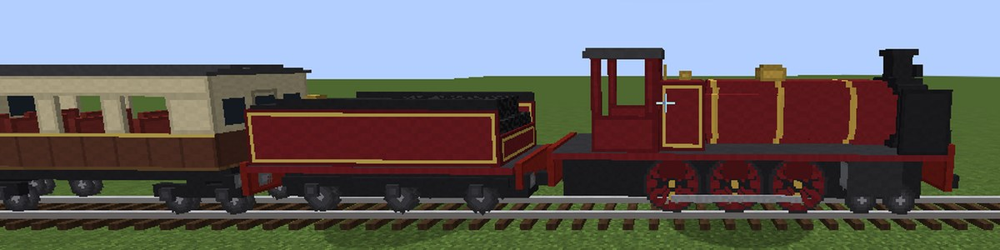

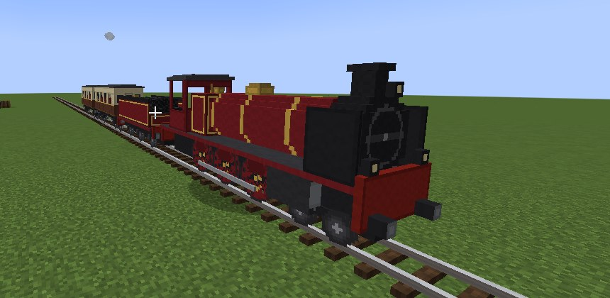

### Water

Steam engines need **water** as well as coal: a tank engine carries 16 buckets in its side tanks, and a tender 64
(the express takes its water from its tender). They use it as fast as they burn coal, so a full load of each lasts the
same. With none left there's no steam: the engine won't go, and its gauges say **NO WATER**. Engines and tenders come
from the works with their tanks full (and ones from before this update are filled when they load).

- **Water Tower**: put one beside the track (up to three blocks away, like a charging point; its spout faces the
  track). It's two blocks tall and holds 256 buckets: fill it with buckets of water, or pipes and pumps (water only).
  Any tank engine or tender in a train standing beside it is filled, 500 millibuckets a tick each (a dry tender in
  about six seconds), its spout swinging down over the track while it does. Put one by a station: a timetabled train
  waits there until it's full. The marks on its gauge show how full it is, a comparator reads it, redstone holds the
  spout up, and clicking it says how much it holds. An empty bucket draws water from it.
- **By hand**: click a tank engine, an express or a tender with a bucket of water (or any other mod's fluid
  container); other mods' pipes can fill them too.
- A server can turn water off (`steamNeedsWater`).

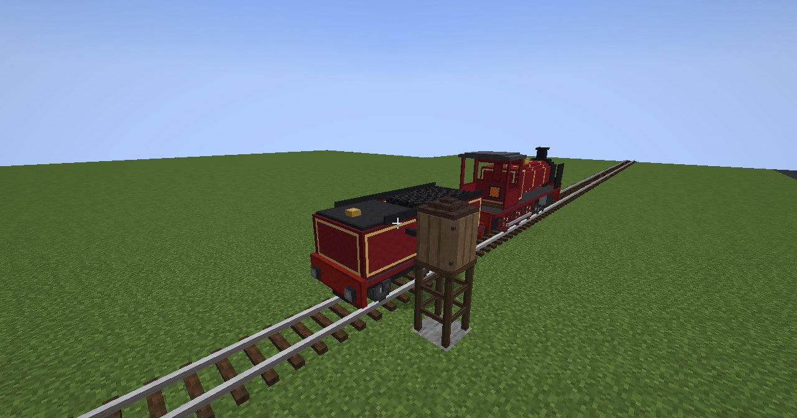

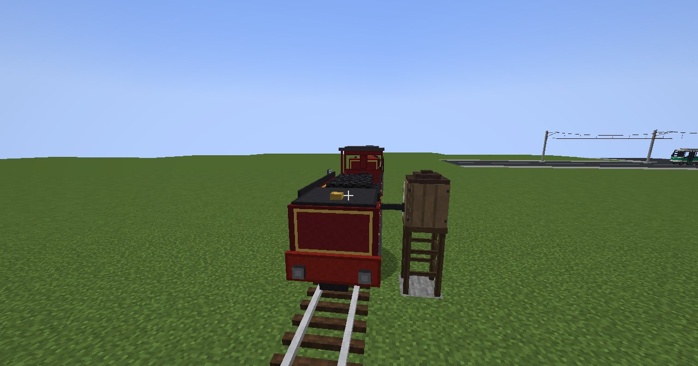

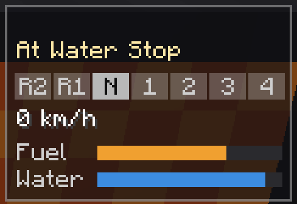

### Turntables and engine sheds

A **Turntable** turns locomotives round at the end of a line, or sends them off down whichever track you like. Use it
on flat ground: it digs its own pit, 15 blocks across, centred on the block you click (the ground must be solid all
over the circle, with nothing standing on it but plants), and sets its bridge in it pointing the way you're looking,
or at track already laid up to the pit's edge. Breaking any of it takes the whole turntable up and gives it back (the
pit stays dug).

- **Track off it**: lay straight track off the pit's edge, in line with its middle: east-west, north-south or
  diagonally (from 8 blocks out from the middle, or 6 diagonally). Lined up with track, the bridge is track: trains
  run on and off it, or straight across.
- **Turning it**: click it (anywhere on its floor) and the bridge turns to the next track round, clockwise;
  sneak-click it to go the other way. A redstone signal beside the pit's edge does the same as it comes on, and a
  comparator beside it reads which way the bridge points (1 for east, round clockwise to 8; 0 while it's turning).
  Half way round takes six seconds.
- **Trains on it**: any train standing all on the bridge goes round with it, passengers and all. It won't turn with a
  train half on it or sticking out over the pit's edge, or moving.
- **Timetables**: put a station by the far end of a turntable at the end of a line, so trains stop all on the bridge.
  A timetabled train that stops there, and would have to back out to get to its next station, is turned round while
  it waits instead, so steam engines always go chimney first.

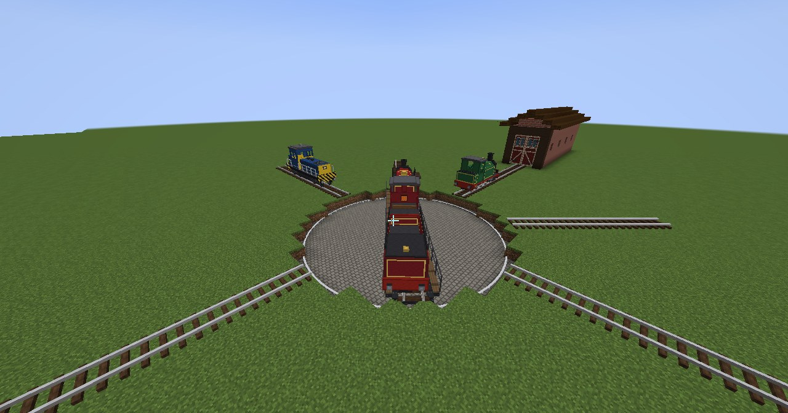

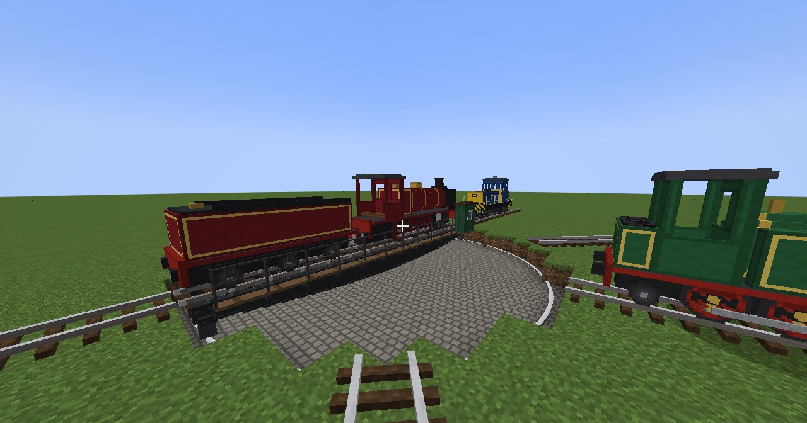

**Engine Shed Doors** are a big pair of timber doors in a frame, for the end of a shed you build round them. Use them
on a straight track block (east-west or north-south) from outside: the frame goes up over the track, five blocks
across and five high, with the doors facing you. They open by themselves as a train comes up to them (sooner the
faster it's going), from either side, and shut once it's gone by. Click them to hold them open, or let them shut;
redstone at the frame holds them open too. Shut, they keep people and animals out.

- **Servicing**: the doors keep a store of engine fuel (coal and the like, nine stacks, from hoppers and pipes or by
  hand), 64 buckets each of water and diesel (from pipes or buckets), and BuildCraft power (as much as a charging point
  holds). Every locomotive and tender standing still on the track inside, up to 32 blocks in from the doors, is topped
  up: coal and water for steam engines and tenders, diesel for diesels, charge for electrics. A timetabled train with
  a station inside waits until it's topped up. Clicking the doors says what's in the store.

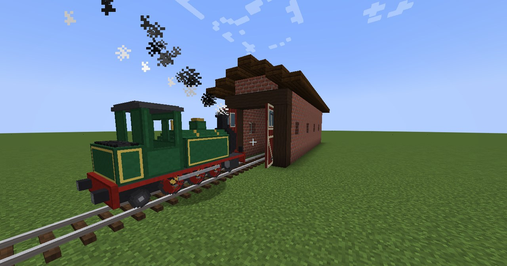

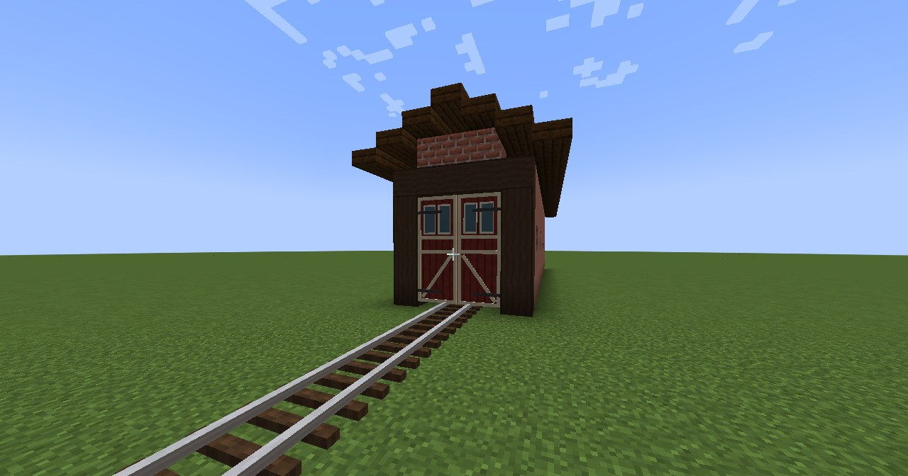

### The diesel

The **Diesel Locomotive** is a road-switcher: a long hood in front of a high cab, so you can see over it whichever
way you're going, and a short hood behind. It rides on two bogies like the coaches.

- It runs on **diesel**, the same as the diesel vehicles in Reiko's Car Mod: BuildCraft Reborn's **Dense Fuel**
  (refined from oil) or **Mixed Heavy Fuels**, or other mods' diesel and biodiesel. Its tank holds 16 buckets of Dense
  Fuel; how far a bucket goes comes from BuildCraft's own fuel values, so a bucket of Mixed Heavy Fuels (worth about a
  quarter as much) goes a quarter as far, and more of it fits. At full throttle a bucket of Dense Fuel lasts about
  five minutes; idling, nearly an hour.
- To fill it, click it with a bucket (or any other mod's fluid container) of diesel, pipe it in, or put a **wagon
  loader** by the track with a BuildCraft tank next to it: a diesel standing there is pumped full, twenty buckets a
  second, and a timetabled train waits until it's done. The diesel won't take coal, and steam engines won't take
  diesel.
- It pulls harder than either steam engine, so it gets a heavy train going quicker than they do, though the express
  is faster flat out.
- Its engine rumbles, and the note rises as the throttle opens. Its exhaust smokes harder the harder it works, with
  a black cloud when you open up. It sounds a two-tone horn instead of a whistle (the same key).

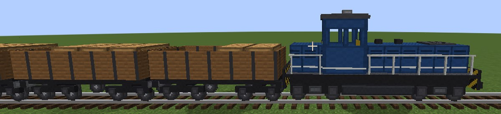

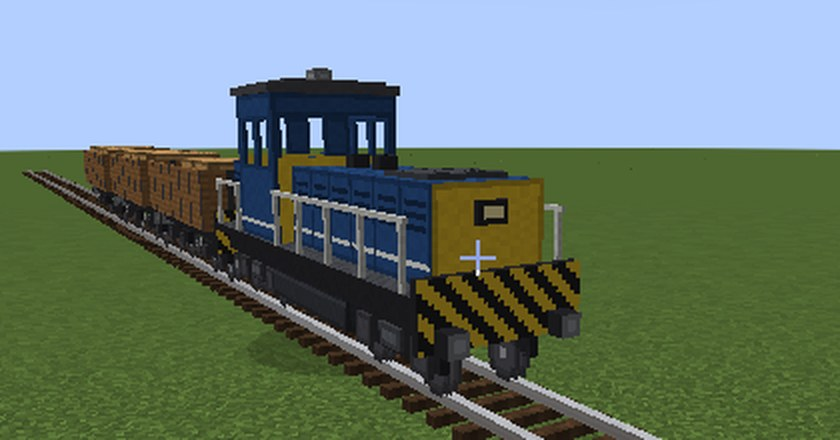

### The electric

The **Electric Locomotive** is a box-cab electric: a full-width body with a cab at each end, yellow noses, louvred
sides, batteries slung between its bogies and a charging socket on each side. You drive it from the front cab.

- It runs on **BuildCraft power** (MJ), stored in its batteries: a million MJ, about twenty minutes at full power.
  Standing with the throttle shut it uses next to nothing (there's no engine to keep running). When the batteries go
  flat it stops, and the gauges say **FLAT**.
- Under **overhead wires** it runs from the wire instead (see below), charging its batteries as it goes.
- It's charged at a **Charging Point** beside the track (up to three blocks away, like a wagon loader; its cable
  reaches out towards the track). Feed the charging point from BuildCraft engines or kinesis pipes on any side (or,
  as BuildCraft's config allows, other mods' energy cables): it stores a million MJ, so a few engines can fill it up
  between trains. Any electric in a train standing beside it is charged at 5,000 MJ a tick (a flat one in ten seconds,
  if the store has enough), and a timetabled train waits while it's charging, until its batteries are full or the
  store runs dry. The bars on the charging point's back show how full its store is, and the lamp on top lights while
  it's charging; click it to see how much it holds. Redstone pauses it, and a comparator reads its store.
- It's the quickest engine there is: it pulls harder than the diesel and goes faster than the express (about
  60 km/h at the default settings).
- Its motors hum, the whine climbing as it gathers speed; working hard, the odd spark flies from under the bogies. It
  has its own two-tone horn (the whistle key). It won't take coal or diesel.

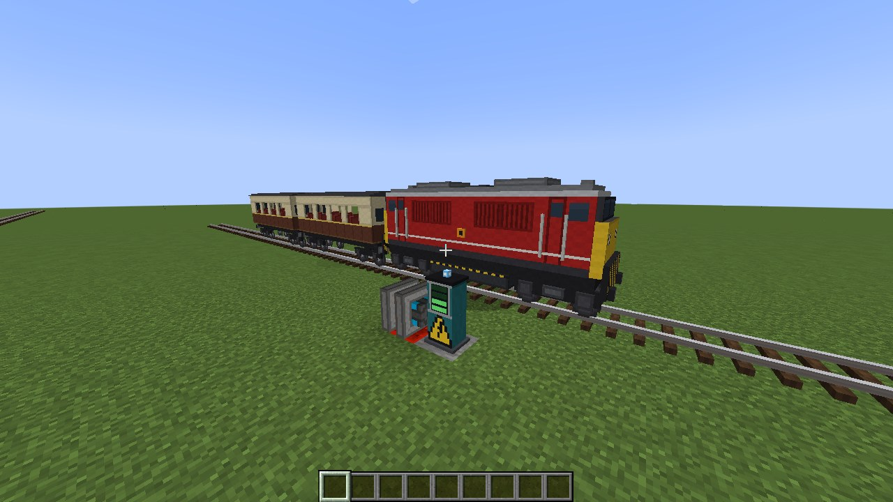

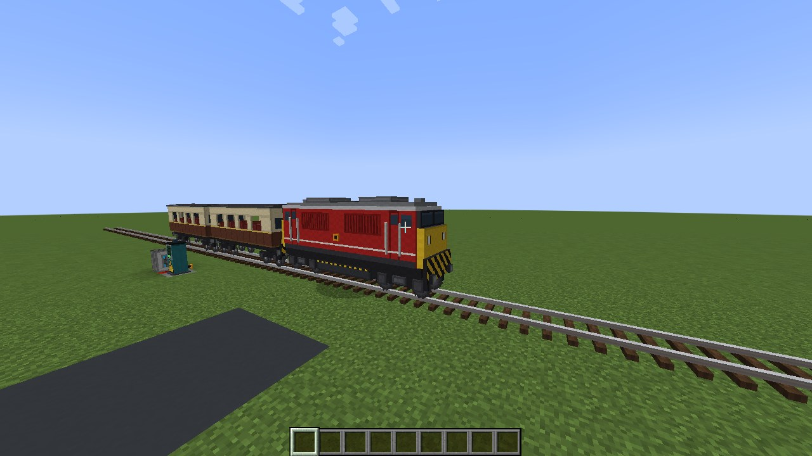

### The Bullet Train

The **Bullet Train** is the fastest thing on the line: about 100 km/h at the default settings, nearly twice the
electric. It's a set, not a locomotive and coaches: a **driving car** at each end, noses out, with **Bullet Train
Coaches** between them (as many as you like, up to the server's train length). White, with the windows in a blue
band and a blue stripe low down.

- Each driving car has a long streamlined nose, the driver's cab behind a sloping windscreen you can see out of, and
  seats for eight more. A coach seats twelve, and there's a gangway between the cars.
- Drive it from either end: climb into the cab at the end you want to lead. Both driving cars pull, so it gets away
  briskly for its size. On a timetable it shuttles back and forth without ever turning round.
- It runs on **batteries**, like the electric, charged at a **Charging Point**: each driving car holds 1,500,000 MJ,
  and both charge at once when the train stands at one. Under **overhead wires** both driving cars raise their
  pantographs and it runs from the wire, charging as it goes. It won't take coal or diesel.
- It has its own horn, a clear two-note call (the whistle key), and its motors whine like the electric's.
- Signals, stations, speed signs and level crossings all look further ahead for it, so it slows in time at full speed;
  and it loads the chunks ahead of it a few seconds early, so it doesn't catch them still loading.

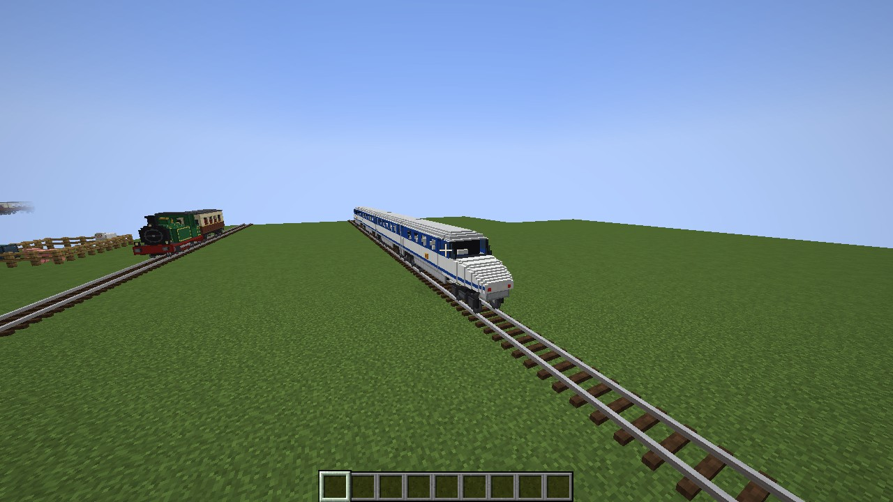

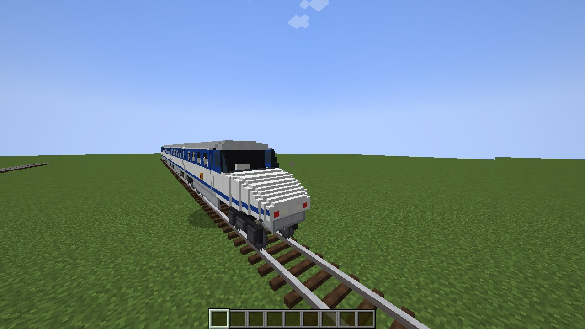

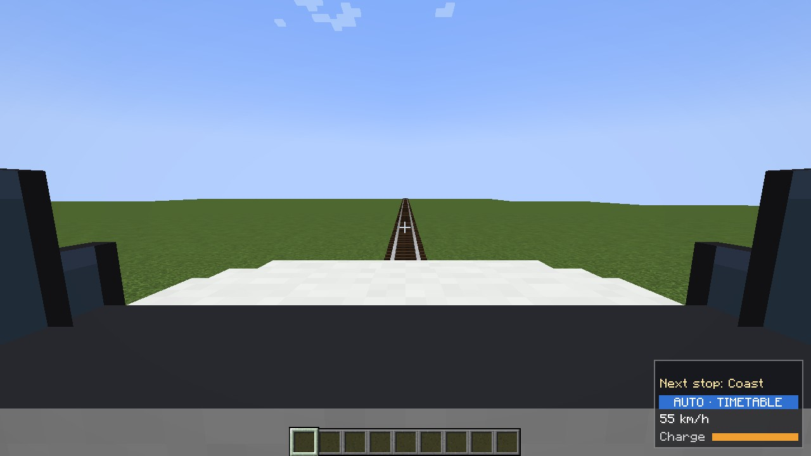

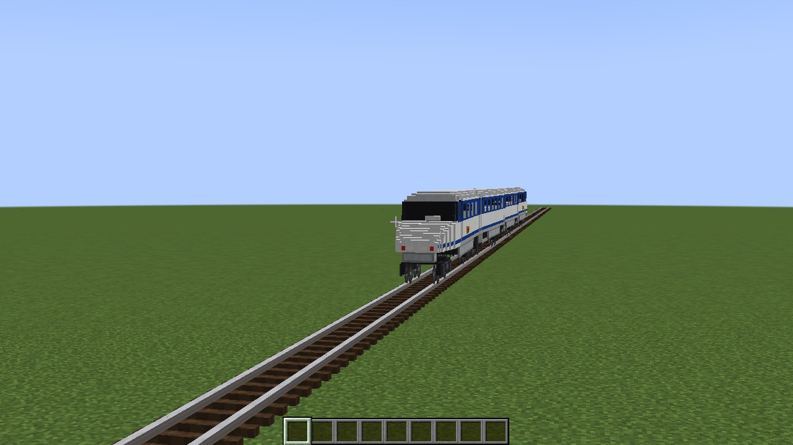

### Overhead wires

Electrify a line and electrics and Bullet Trains run from the wire, as far as it goes, charging their batteries on
the way: no more stopping to charge.

- **Masts**: put an **Overhead Line Mast** beside the track, up to three blocks from it (curves too). Its pole goes
  up, and its arm reaches out over the track to hold the contact wire there, four and a half blocks above the rails.
  Space them along the line, on either side, up to 32 blocks apart (closer on curves, as the wire runs straight from
  mast to mast).
- **Wire**: hold **Overhead Wire**, click a mast, then the next mast along: a span of wire goes up between them (one
  wire a span), the contact wire with the messenger wire sagging above it and droppers between. You're ready to go on
  to the next mast straight away; click the same mast twice, or sneak-click the air, to stop. A mast holds up to four
  spans, so lines can branch at junctions. Sneak-click a mast with wire to take its spans down (you get the wire
  back). Breaking a mast drops its spans' wire.
- **Power**: masts wired together make a line. Put a **Substation** within four blocks of one of its masts and feed
  it from BuildCraft engines, kinesis pipes or other mods' cables, as you would a charging point. Each substation
  gives its line room to store a million MJ, shared by the whole line, however long. Its bars show how full the
  line's store is, its lamp lights while the line is live, a comparator reads it, and clicking it says how much the
  line holds and how many masts it has. Lines joined up share what they had; a line split shares it out by masts.
- **Trains**: an electric or a Bullet Train under a live wire raises its pantograph against it. While it's up, the
  train runs from the line's store and leaves its batteries alone, and charges them from it at 2,000 MJ a tick (a flat
  electric in under half a minute); so it gets going even with flat batteries. The fuel gauge reads **Wire**. Past
  the end of the wire, or under a dead one, the pantograph comes down and it runs on its batteries again.

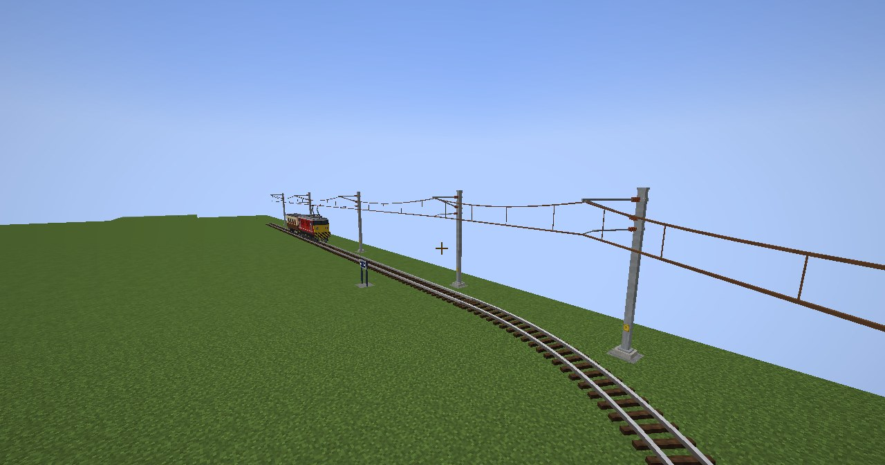

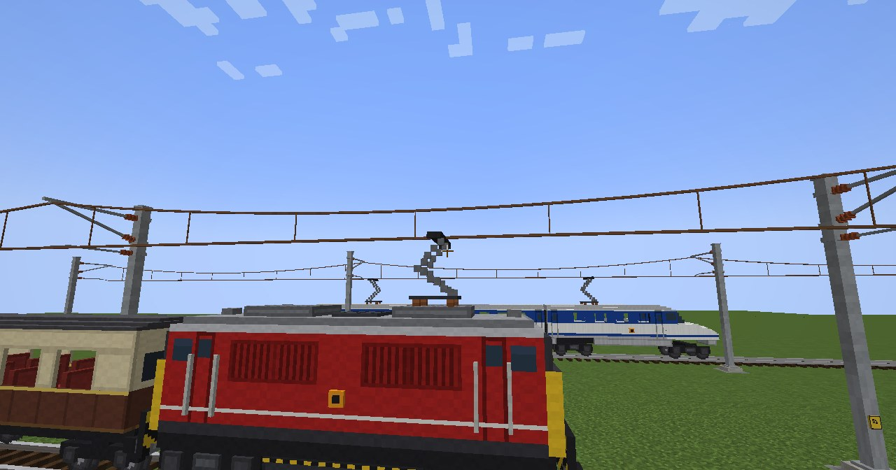

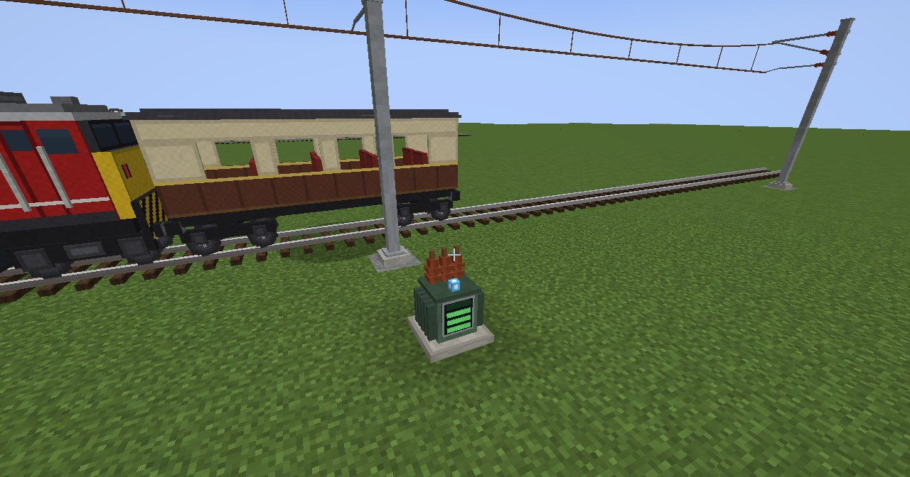

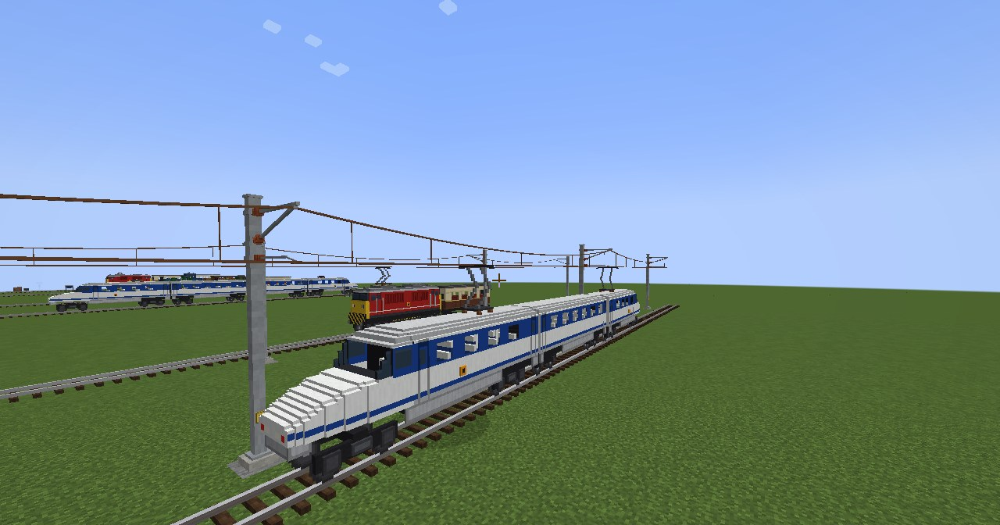

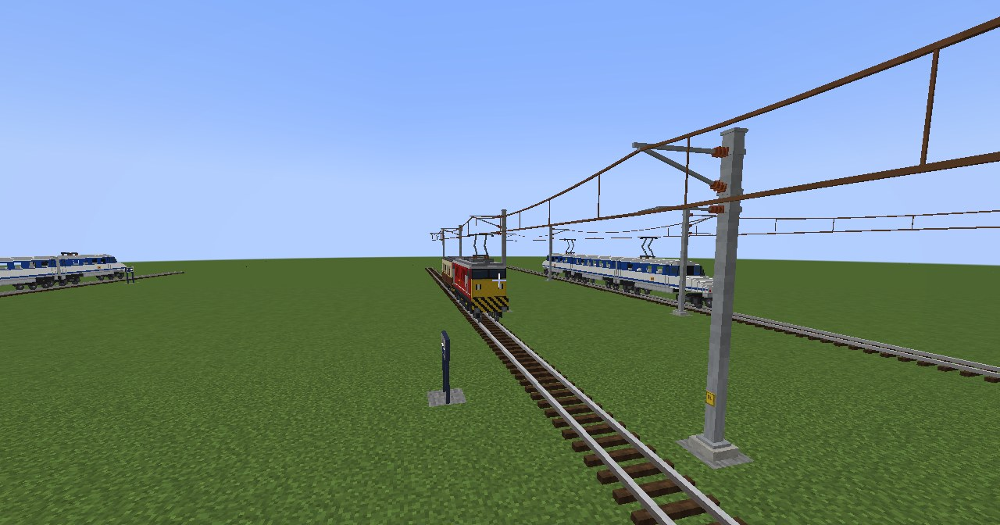

### Trams

Two trams, made for **street track** and the **overhead wires**. Both run from the wire, charging a small battery
(60,000 MJ a driving end) that gets them over junctions and short gaps in it, or charge at a charging point; both
ring a bell (the whistle key); and both keep to **street rules**.

- The **Vintage Tram** is a single car, seven blocks long: red below and cream above, a clerestory roof, and at each
  end an open platform with the controller, a headlamp, a destination box and a lifeguard. It runs both ways: get in
  as the driver at the end you want to lead, and the throttle takes it that way. Its trolley pole trails behind it to
  the wire, and swings round when it changes ends. About 40 km/h, and nine seats. Its bell is a foot gong.
- The **Low-Floor Tram** is three sections that bend in the middle: a driving section at each end (noses out, a
  pantograph over each one's inner end) and a short middle one, about fourteen blocks in all, white with a green band
  and big windows, its floor a step above the street. Click a track block with it to put all three on the track
  together, the middle one there; breaking any of them takes the whole tram up. Drive it from either end. About
  50 km/h, and fourteen seats (the two drivers' included). Its bell is an electronic chime.
- **Street rules**: a tram (or any train with one in it) stops a block or so short of anything on the track ahead:
  people, animals, cars, boats, other trains (it doesn't couple to them). On a timetable it waits for them to clear,
  ringing its bell now and then. With Reiko's Car Mod, it also stops at **red traffic lights** beside the line that
  face it (and at amber ones, if it can stop in time), and goes on when they turn green; they show on the gauges like a
  signal. It brakes harder than a train, too. Ordinary trains carry on as before.

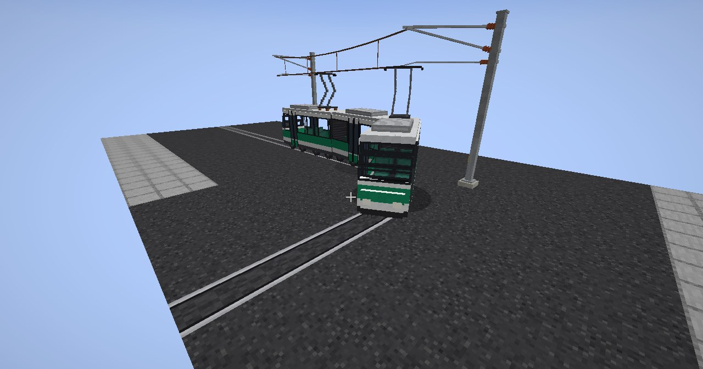

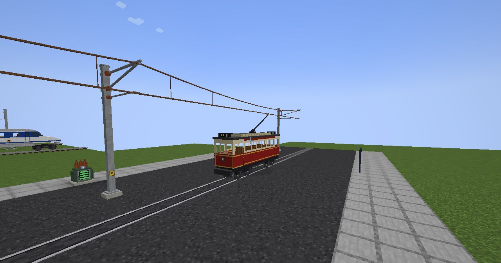

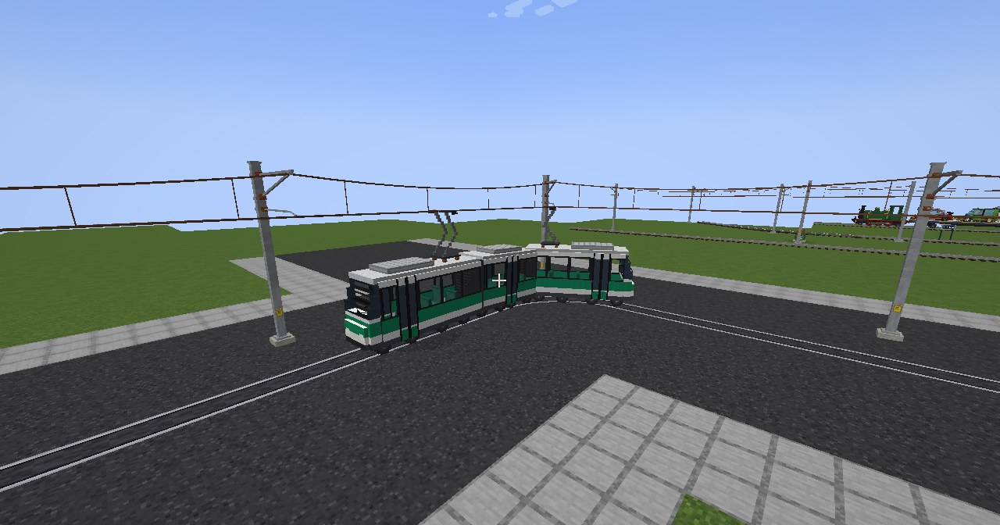

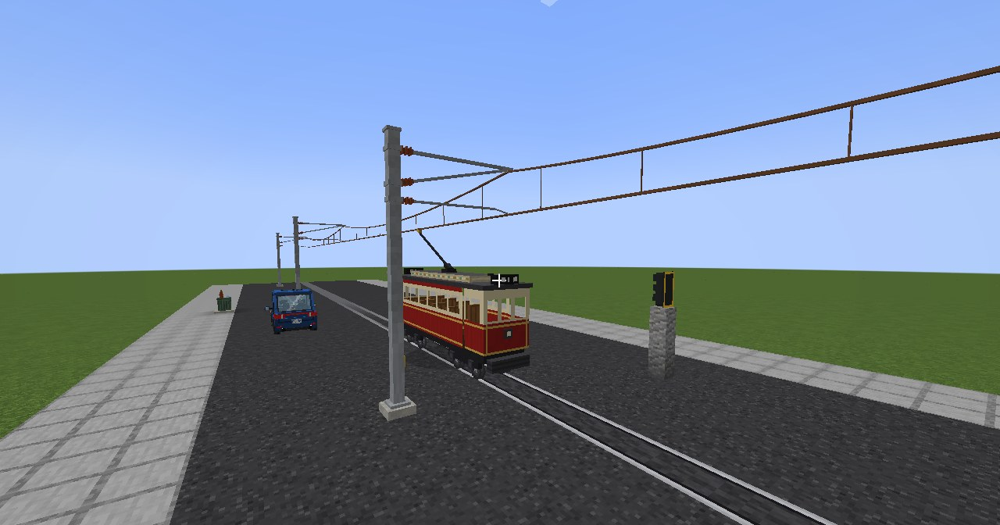

### Tank wagons and guard's vans

The **Tank Wagon** carries 256 buckets of one fluid at a time. Click it with a full bucket (or any other mod's fluid
container) to pour it in, or with an empty one to draw some off; click it empty-handed to see what's in it. Pipes
can fill and empty it too, and a **wagon loader** with fluid tanks next to it fills tank wagons (loading) or empties
them (unloading), twenty buckets a second each (a full one in about 13 seconds): so a train can carry BuildCraft's oil or fuel from a refinery to a
depot by itself. The gauge on its side lights a quarter at a time as it fills; a full one is heavier to pull. If a
tank wagon's broken up, what's in it is lost.

The **Guard's Van** goes on the back of the train. It seats two (by the stove, which smokes while someone's aboard,
and by the window), has red tail lamps on its back end, and an open veranda on its front. Its brake works with the
train's: with a van on, a train's brakes are half as strong again (two vans count, at most), so a heavy train stops
quicker. And a train left with no engine is held by the van's handbrake, so loose wagons don't roll away.

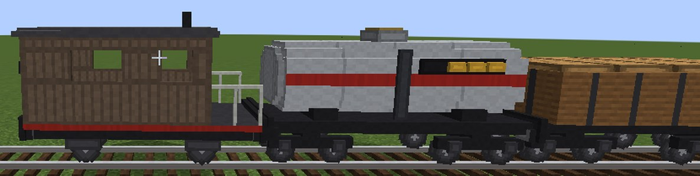

### Livestock wagons

The **Livestock Wagon** is a roofed van with slatted sides and a sliding door, and six stalls inside, three rows of
two, for any animals: cows, sheep, pigs, chickens, goats, horses, llamas... (not tamed pets).

- **Lead** animals up to it and click it: as many as there's room for go in, and you get the leads back.
- **Sneak-click** it empty-handed to let them all out beside you. Clicking it otherwise says how many stalls are taken.
- Aboard, the animals ride facing along the wagon, and come to no harm from walls, falls or crowding. They're carried
  along with the wagon when it's saved and loaded, and a fuller wagon is heavier to pull.
- People can't ride in it.
- A **wagon loader** works with it too (see below): loading, it puts the animals standing around it into the train's
  livestock wagons; unloading, it lets them out behind it. So a timetabled train can take the sheep from the farm to
  market by itself.

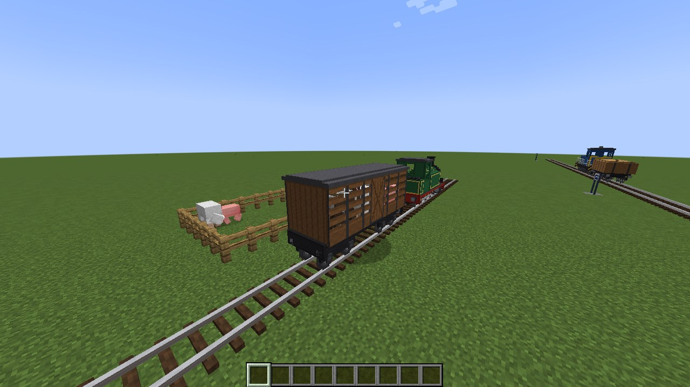

### Car transporters

The **Car Transporter** is a long, low flatbed, twelve blocks long, with tyre tracks along its deck, yellow guard
rails and hinged plates at each end. It carries the cars, vans, trucks and buses of
[Reiko's Car Mod](https://github.com/Reiko45/Reiko-s-Car-Mod) (without that mod it carries nothing).

- **Driving on**: with the train stopped, drive up to a free end of a car transporter, lined up with it, and keep
  going (forwards, or backwards if you're reversing on). The car rolls aboard and along to the far end, or up to the
  cars already there. If the transporter's empty and there's another one coupled beyond it, it carries on to that
  one, so a train of them fills up from the far end, as real car trains do. Cars go on end to end: the deck takes
  11½ blocks of them: three cars, or a bus.
- **Aboard**, a car stays where it is: it doesn't drive, burn fuel or wear. Its driver can stay in it for the ride,
  or get out. A loaded transporter is heavier to pull.
- **Driving off**: sit in it with the train stopped and keep going forwards or backwards. It drives off the end of
  the train that way if there's room, or on along the train to the next car transporter. Another car in the way, or
  another kind of car coupled at that end, stops it.
- It won't take a car that's towing a trailer or another car (unhitch first), or one that doesn't fit.
- Clicking it says how many cars are aboard. The cars are saved with it, in their places.

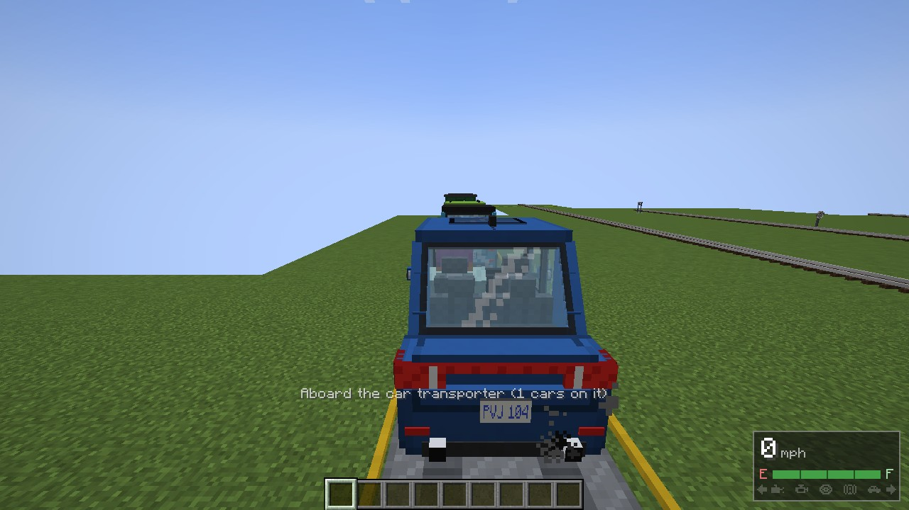

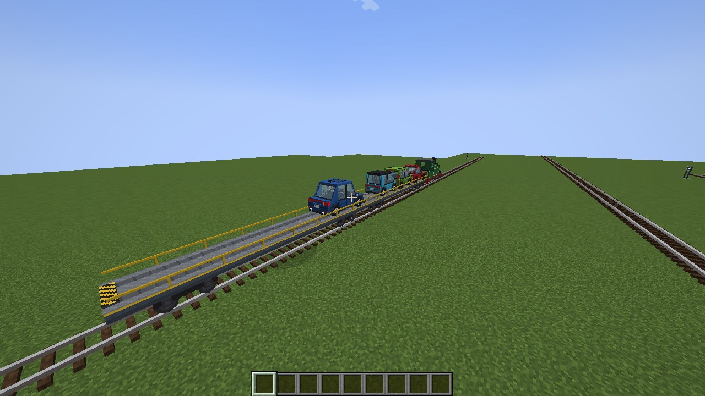

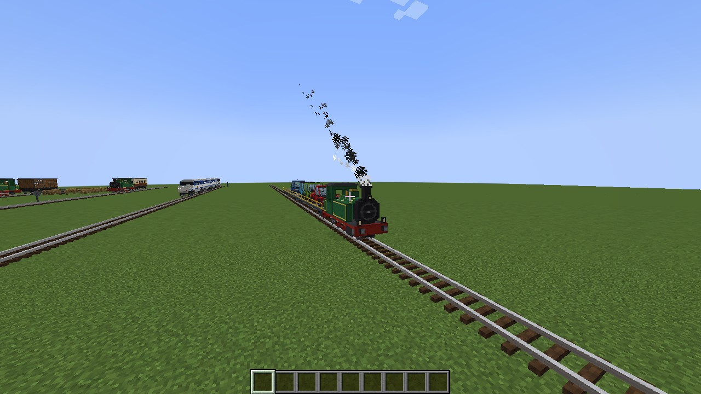

### More than one locomotive

A train can have several locomotives, anywhere in it and facing either way: double-head a heavy train, or put a
banking engine at the back to push. One is in charge: the one running a timetable, or else the one someone's driving
(the first one, if several are). The others work with it, notched up the same (turned round, if they face the other
way), and every engine with steam adds its pull, each up to its own top speed. They each burn their own fuel. Their
fires stay lit while the engine in charge is driven, so nobody has to ride in them.

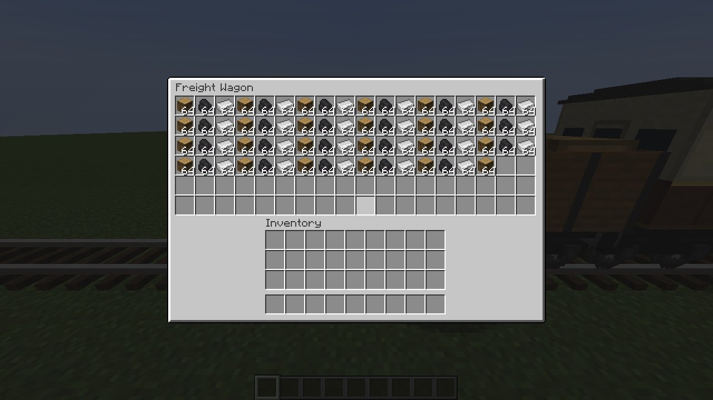

### Server settings

In `serverconfig/reikotrains-server.toml` in each world:

| Setting | Default | |
| --- | --- | --- |
| `needsFuel` | `true` | Turn off for trains that run on nothing |
| `fuelUse` | `1.0` | How fast fuel burns (1.0: a coal lasts about 3 minutes at full throttle) |
| `maxSpeed` | `0.6` | Top speed in blocks per tick (0.6 is 12 blocks a second) |
| `acceleration` | `0.004` | How quickly a locomotive with two coaches picks up speed |
| `signalsStopDrivers` | `true` | Whether trains people drive stop for red signals by themselves (and keep to caution speed past yellow ones) |
| `cautionSpeedKmh` | `40` | How fast trains may go past a yellow signal, until the next signal |
| `trainsOnMinimaps` | `true` | Whether players are told where every train is, for Xaero's Minimap |
| `speedLimitsForDrivers` | `true` | Whether trains people drive keep to speed limit signs by themselves |
| `maxTrainLength` | `16` | The most cars in one train |
| `loaderSpeed` | `640` | How many items a wagon loader moves a second (640 fills a wagon in about 11 seconds) |
| `fallbackDieselEnergyPerBucket` | `96000` | MJ in a bucket of a diesel fluid BuildCraft has no fuel value for |
| `steamNeedsWater` | `true` | Whether steam engines need water as well as coal |
| `waterTowerRateMB` | `500` | Millibuckets a tick a water tower puts into each tank engine or tender at it |
| `chargingPointCapacityMJ` | `1000000` | MJ a charging point stores |
| `chargingPointRateMJ` | `5000` | MJ a tick a charging point puts into each electric standing at it |
| `substationCapacityMJ` | `1000000` | MJ each substation adds to its overhead line's store |
| `wireChargeRateMJ` | `2000` | MJ a tick an electric (or Bullet Train driving car) charges at under a live wire |
| `crossingWarningSeconds` | `10` | How long before a train arrives level crossings start warning |
| `giveHandbook` | `true` | Whether each player is given the Railway Handbook the first time they join (needs Patchouli) |

The fuel steam engines take is the item tag `reikotrains:locomotive_fuel`, and the diesel's is the fluid tag
`reikotrains:diesel` (BuildCraft's Dense Fuel and Mixed Heavy Fuels, and `c:diesel`, `c:biodiesel` and the like, as
in the car mod), so a datapack can change them.

## Signals

Put a **Railway Signal** beside the track (up to three blocks away; leave a block's gap so trains clear it), looking
along the line the way the trains will go. It guards the track ahead that way, up to the next signal facing the
same way (down every branch of any junctions). It shows **red** while any train is on that stretch, and **green**
when it's clear. Its lamps face the trains coming towards it.

- Trains stop just short of a red signal and go on when it turns green: trains on a timetable always, and trains
  you're driving too (the server can turn that off with `signalsStopDrivers`). The cab gauges show the next signal and
  how far it is.
- **Redstone** holds a signal at red: wire it to a lever to stop trains by hand.
- A **comparator** beside a signal reads 15 while there's a train on the stretch ahead.
- Signals face one way, and they also tell trains on a timetable which way the line runs: a loop signalled one way
  round is run that way round.

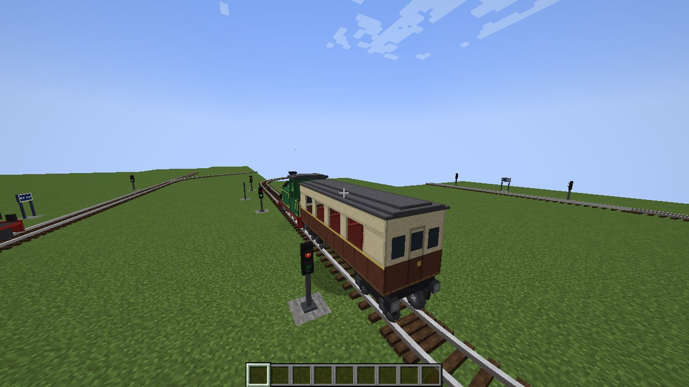

### Three-light signals

A **Three-Light Signal** goes up just like a Railway Signal, guards its stretch of track the same way, and shows red
while there's a train on it. But while it's clear itself and the **next** signal along the line (the way the switches
are set) is red, it shows **yellow**: a warning that the train will have to stop at the next one.

- A train going past a yellow signal keeps to **caution speed** (40 km/h; servers can change it with
  `cautionSpeedKmh`) until it gets to the next signal, slowing in time to pass the yellow at that speed, so it can stop
  for the red one in good time however fast it was going. If the next signal turns green before it gets there, it's
  let go and speeds up again. Trains on a timetable always do this; trains you're driving do too unless the server's
  `signalsStopDrivers` is off.
- The cab gauges show the yellow lamp, and the caution speed as a speed limit.
- A **comparator** reads 15 while there's a train on the stretch ahead, and 7 while it shows yellow.
- Mix them with the two-light signals as you like: a three-light signal looks at whatever kind of signal comes next.
  Put them where trains need warning, like before a station's platform signal or on a fast main line.

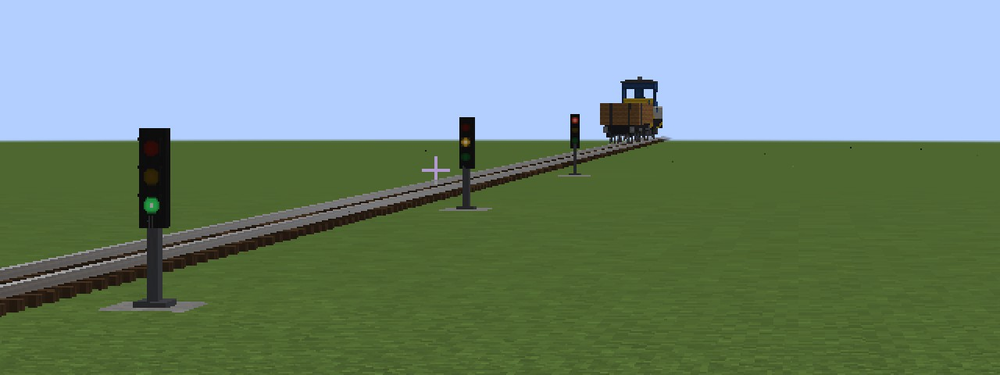

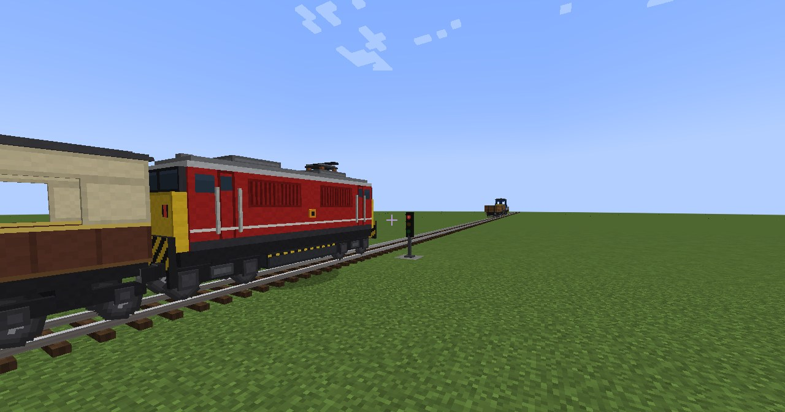

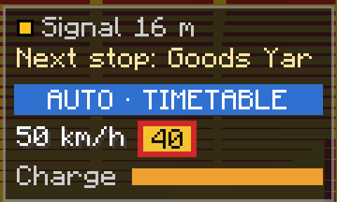

### Signal boxes

A **Signal Box** is a desk with a lever frame along it and a diagram of the line on a board at the back. Put it
wherever you like (build the signal box round it), and click it: its screen is a **live map** of the railway within
96 blocks of it, north up, drawn from the real track.

- **On the map**: the track in light grey, curves and all; turntables, their bridges turning; stations by name; every
  train car as it goes (locomotives orange); each signal as a lamp beside its track, red, yellow or green, with a tick
  showing which way it guards; and each switch, the way it's set picked out in yellow. The box itself is the white
  square. Hover over anything to see what it is (a train shows its timetable's next stop).
- **Throw switches**: click a switch on the map to throw it to its next way, as clicking its stand does (one held by
  redstone won't throw).
- **Hold signals**: click a signal to hold it at **red**, so trains stop at it, and click again to let it go. A held
  signal has a white ring round its lamp. Breaking the box lets go of every signal it was holding.
- Drag the map to move it about and scroll to zoom. The map keeps up five times a second while you have it open; new
  track shows up within a few seconds.


## Speed limits

Put a **Speed Limit Sign** beside the track (up to three blocks away), looking along the line the way the trains will
go, like a signal: its face is towards the trains coming up to it. **Click** it to change its limit: 10 to 90
km/h in tens, or the **end of a limit** (white, crossed with black lines). A new one says 20.

- Trains going towards its face slow down in time to pass it at the limit, and keep to it from there until the next
  speed sign their way. An end-of-limit sign lifts it. A higher limit takes over as soon as the train reaches it.
- Trains going the other way take no notice, and a train that sets off back the way it came leaves its limit behind.
  So put up signs for each way the trains run.
- Trains on a timetable always keep to the limits, and trains you're driving do too (the server can leave it to the
  drivers with `speedLimitsForDrivers`). The cab gauges show the limit beside the speed, yellow while the train is
  slowing for a lower one ahead.

Use them for sharp curves, junctions, stations trains run through, or a level crossing in a village.


## Switches

Put a **Switch Stand** beside a junction, within three blocks of the track block where the line divides. From then
on that junction goes the way the switch is set, for every train going through it towards the fork:

- **Normal** (green target): the straightest way.
- **Thrown** (yellow target, lever over): the way that branches off.

Click the stand to throw it over or put it back. Where three ways leave the same end of a block, clicks go round them:
left, right, straight on.

**Redstone** sets the switch and holds it there; clicking does nothing while it's powered, and when the power goes
off it's let go and goes back to normal. **Sneak-click** the stand to choose what redstone does: throw it (to the
left or the right branch, at a three-way junction) or hold it straight on. A new stand throws it. Trains coming the
other way (out of either branch towards the main line) just run through.

The **marker** on the stand's post (the red box under the target) shows what redstone does to it: **yellow**, redstone
throws it; **green**, redstone holds it straight on. It lights up while redstone is holding the switch.

Trains on a timetable set an unheld switch for themselves as they come up to it, to the way to their next station.
A switch held by redstone they have to obey, so redstone can keep them off a branch, or send them round a different way (or into a siding).
Drivers' A / D steering only counts at junctions with no switch. Throwing a switch under a train doesn't split it:
the cars behind follow the engine.


## Track sensors

Put a **Track Sensor** beside the track (up to three blocks away; its red eye faces the track). It gives off a
**redstone** signal while a train is over the track block beside it, moving or standing still, and its eye lights up.
A **comparator** next to it reads how many cars the train has (up to 15).

- **Click** it to choose which way trains must be going to set it off: either way, or only **left** or only **right**
  as you stand behind it looking at the track. The arrow on top shows which. A train that stops over it keeps it on.
- **Click it with an item** to sense only some trains. The item shows in the frame on its back:
  - a **locomotive, coach or wagon**: only trains with that kind of car (an electric, a tank wagon, a guard's van...);
  - a **timetable**: only trains running that timetable (the same stations in the same order, starting anywhere), or,
    with a blank one, any train on a timetable;
  - a **spawn egg**: only trains carrying that animal in a livestock wagon;
  - a **filled bucket** (or other mod's fluid container): only trains with a tank wagon of that fluid;
  - **anything else**: only trains carrying it in a freight wagon (or a tender, for coal).
- **Sneak-click** it empty-handed to sense every train again.

Put one beside a junction's track block, filtered for freight wagons and wired to the switch stand there, and goods
trains are sent into the yard while the rest go the way the switch is set (redstone holds the switch while the train
is over the sensor). Or count the cars of a passing train, ring a bell when the express comes through, open a door for
the diesel.


## Level crossings

Where a road crosses the line, put a **Level Crossing** at the side of the road, within three blocks of the track,
from the road: its arm comes down **towards you**, across the road. Click the post to set how far the arm reaches
(one to eight blocks; it starts at four). Real crossings have one on each side of the line, and often one on each side
of the road too, their arms meeting in the middle.

When a train is coming, due at the crossing within ten seconds (a server setting), the two red lamps on each face of
the post start flashing turn about and the bell rings. Three seconds later the arm swings down, taking two seconds
over it. It stays down while any part of a train is on the crossing (within eight blocks of the track block nearest
the post), and goes back up when the last train's gone by and no other is coming; the lamps go out once it's up. A
train heading away doesn't set it off, nor one standing a little way off, waiting.

While the arm is down nothing can drive through it: under the arm there's an unseen barrier a block and a half high,
taller than the car mod's cars can climb, so they stop and wait. (Put the post on the same level as the road.) Where
something is standing under the arm as it comes down, it leaves a gap there so nothing's trapped, and fills it in once
it's moved. The crossing also gives off a **redstone** signal while it's warning, for your own lamps or bells.


## Stations and timetables

Put a **Station** beside the track the same way. Click it to name it (or name it in an anvil first) and set how long
trains on a timetable wait there (2 to 120 seconds). It gives a **redstone signal** while a train is standing at it:
handy for doors, lamps or a bell.


To run a train by itself:

1. Click stations with a **Timetable**, in the order you want them called at (up to 16). Its tooltip lists them.
   Clicking the station you just added again says what the train does with wagons there (see below).
2. Fuel the locomotive, and click any car of the train with the timetable. Off it goes.

A train on a timetable runs to each station in turn and round again: it draws up with its front at the nameboard,
waits, whistles, and sets off for the next. It picks its way at junctions (the way that leads to the next station),
stops for red signals, and backs out of dead ends: at a terminus it just reverses (unless it's stopped on a turntable,
which turns it round). Passengers see the station names
as they go. Climb into the cab and touch the throttle or brake to take over; sneak-click the train with the timetable
to stop it running. Sneak-click the air with a timetable to clear it.


### Leaving wagons and picking them up

When you've added a station to a timetable, click it again with the same timetable to say what the train does with
wagons there. Each click goes on to the next, and round:

- **Leave a wagon**, **leave 2**, **3** or **4 wagons**, or **leave all its wagons**: before it sets off again, the
  train uncouples that many cars from its end and leaves them standing at the station. Coaches count too, and so does
  a guard's van at that end; "all" means everything up to the locomotive (a tender stays with its engine).
- **Pick up waiting wagons**: if there are wagons (cars with no locomotive) standing at the station, anywhere from 32
  blocks short of the nameboard to 24 past it, the train runs up to them instead of stopping at the nameboard, couples
  on, and takes them with it. With none there, it's an ordinary stop.
- **Nothing to do with wagons**: back to an ordinary stop.

The timetable's tooltip shows what each stop does. The cars a train leaves are the ones at the end it won't be leading
with when it sets off for its next stop:

- Going on through the station, it leaves the ones at its back.
- Coming back out of a dead-end siding, it leaves the ones at the far end, so it needs its locomotive at the back going
  in, pushing the wagons ahead of it (trains on a timetable push as happily as they pull). A locomotive that went in
  first can't leave the wagons behind it, as there'd be no way round them: it takes them back out.

Leave wagons on level track: loose wagons roll on a slope. For example, a goods train running Quarry, then Yard
(leave 2 wagons), round and round, leaves two wagons at the yard every trip; a second engine running Yard (pick up
waiting wagons), then Works (leave all its wagons), collects them and delivers them to the works.


## Loading and unloading freight

Put a **Wagon Loader** beside the track (up to three blocks away, and two is best: its chute reaches over to the
wagons), and storage next to it on any side: chests, barrels, hoppers, or other mods' storage. When a train stands
still with a car alongside the loader, the loader works on every freight wagon, tank wagon and livestock wagon in the
train, front to back:

- **Loading** (green arrow on top, pointing at the track): it fills the wagons from its storage, the tank wagons
  from fluid tanks next to it, and the livestock wagons with animals standing around it (within four blocks: build
  the pen behind it).
- **Unloading** (orange arrow, pointing away): it empties them into its storage and tanks, and lets the animals out
  behind it, on the side away from the track.

Sneak-click the loader to switch between the two, or click it to open its screen (below). Its lamp lights while it's
moving goods. It moves ten stacks a second
(server setting `loaderSpeed`), so a full wagon takes about 11 seconds; two loaders at one train work twice as fast.

- **Redstone** pauses it.
- A **comparator** beside it reads how full the train's wagons (tank and livestock wagons too) are (0 with no train
  there).
- Hoppers and pipes can also go through it: into the train while it's loading, out of it while it's unloading.
- Loading, it refuels the engines too: a tender takes coal (and the like) from its chests, and a diesel is pumped
  full of diesel from fluid tanks next to it (a BuildCraft tank, say).
- A train on a **timetable** waits at a station until the loaders beside it have finished with it: its time at the
  station is the least it stays. The cab shows "loading" or "unloading" meanwhile. A loader counts as finished when
  it's had nothing to move for a second (the wagons are full, or its storage is empty, or full when unloading).

A freight train can then run a round trip by itself: load at the mine, unload at the yard.


### Filters

Click a loader to open its screen: a row of nine **filter** slots, a button for loading or unloading, and a button for
what the filter does:

- **Only these**: it moves only the items shown.
- **All but these**: it moves everything except the items shown.

To put an item in the filter, click a filter slot holding it, or shift-click it in your inventory: the filter shows a
copy, and the item stays yours. Click a slot empty-handed to clear it. An empty filter moves everything.

A filled bucket (or any mod's fluid container) in the filter stands for its fluid, for tank wagons: put a bucket of
water in an "only these" filter and the loader fills tank wagons with water only, leaving the lava tank beside it
alone. A spawn egg stands for its animal, for livestock wagons: a sheep egg in an "only these" filter loads just the
sheep from a pen of mixed animals. Items, fluids and animals are filtered separately: with only items shown, fluids and
animals aren't filtered, and so on. Engines' fuel isn't filtered either, so a loader with an iron-only filter still tops up a tender's coal and a
diesel's diesel. Hoppers going through the loader are filtered too.

So one station can load iron into one train and coal into another, or unload just the logs and leave the rest.


## Trains on the minimap

With **Xaero's Minimap** installed, every train in your dimension shows on the minimap, however far away: a marker at
its leading locomotive, coloured and lettered by the kind of engine (**St** steam, **Ex** express, **Di** diesel,
**El** electric, **Bu** Bullet Train). Its name says how many cars it has and, on a timetable, where it's going or which station it's at:
*Express Locomotive · 4 cars · to Riverside*. Trains far off move every couple of seconds; nearby ones move with the
train. They're marked in the world too, like Xaero's waypoints, but they don't go in your waypoint list. The train
you're on isn't shown.

Trains stay on the map where they last stood when their chunks unload, and come off it when they're broken up.
Trains without a locomotive aren't shown.

Each player can hide them with `trainsOnMinimap` in `config/reikotrains-client.toml`, and a server can stop telling
players where the trains are with `trainsOnMinimaps` in its server settings.


## Upgrading from 0.1.0

0.1.0's trains ran on minecart rails. In 0.2.0 they're bigger and need Train Track, so any 0.1.0 train cars in a world
turn back into items (dropped where they stood) the first time they load. Put them back on the new track.

## Building from source

You need Java 21. BuildCraft Reborn's jar is in `libs/` (the build and the dev runs use it). Then:

```sh
./gradlew build              # the mod jar ends up in build/libs/
./gradlew runClient          # a dev client with the mod
./gradlew runGameTestServer  # runs the game tests and exits
```

JEI and Patchouli are optional too: the mod compiles against their APIs (from Jared's Maven) and the dev runs load the
full mods, so you can read the handbook and look things up in JEI. `-PnoOptionalMods` leaves them out, to try the mod
without them.

Xaero's Minimap and Reiko's Car Mod are optional, so the train mod compiles against stand-ins for the few of their
classes it uses (`src/stubs/`), which never go in the jar. To try them in a dev client (or the game tests), put their
jars in folders and pass them: `./gradlew runClient -PxaeroJars=/path/to/folder -PcarJars=/path/to/other/folder` (the
car mod needs Reiko's Economy's jar there too).

The **game tests** (`src/main/java/com/reiko/trains/gametest`) build real track and run trains on it: straight lines
joining up, the curve rules (radius, steepness, direction) and taking curves apart, cars sitting on their bogies,
steaming off, running out of fuel, the brake and handbrake, buffer stops, reversing and pushing, going round a loop of
curves without coming apart, steering at a junction, rolling down and climbing a ramp, coupling (nose to nose, either
end), saving, derailing when the track goes, the 108-slot wagon with a hopper, fuel and
recipes. `SignalGameTests` covers signals (red with a train ahead, green when it's gone, redstone, comparators),
drivers stopping at red, stations' redstone, the timetable item, a timetabled train shuttling between two stations,
waiting at a signal, taking a branch to reach its station, handing over to a driver, and two timetabled trains
sharing a signalled loop without ever meeting. `SwitchGameTests` covers switch stands finding their junction, the marker showing what redstone does,
clicking and redstone (holding it thrown or straight on), three-way junctions, drivers going the way the switch is set whatever they steer, throwing a
switch under a train without splitting it, and timetabled trains setting switches their way or obeying a held one.
`LivestockGameTests` covers the livestock wagon: leading six cows in (the seventh left over, the leads given back,
people kept out), letting them out, riding safely along, a wagon loader loading only the animals its spawn-egg filter
picks and letting them out behind it, and a sensor picking out trains carrying sheep. `ShuntingGameTests` covers
leaving and picking up wagons: leaving the last wagon at a through station, pushing wagons
into a dead-end siding and leaving them all there, an engine that went in first keeping its wagons, picking up
wagons waiting past the nameboard and taking them on, a pick-up stop with nothing waiting, and the timetable's clicks
and saving. `SensorGameTests` covers track sensors: on while a train passes and only then, staying on under a standing train with
a comparator counting its cars, sensing only trains going its way, filters by kind of car, cargo, fluid and timetable
(the same stations round from either end, or a blank one), clicking to set and clear them, and, wired to a switch
stand at a junction, sending goods trains down the branch while other trains go straight on.
`SpeedSignGameTests` covers speed limit signs: a driven train slowing in time for one and keeping to it after, a
timetabled train keeping to one all the way to its station, an end-of-limit sign lifting it, trains going away from
a sign's face taking no notice, a train backing away leaving the limit behind, and clicking to change the limit.
`CrossingGameTests` covers level crossings: a train on the crossing setting the lamps going, then the arm and its
barrier (too tall to drive over) coming down and going up again, the redstone signal, warning ahead of an
approaching train and opening once it's past, ignoring a train going away, leaving a gap for something under the arm,
clicking to change the arm's length, and breaking the post taking its barrier with it.
`LocomotiveGameTests` covers the diesel (filling it with buckets of BuildCraft's Dense Fuel and Mixed Heavy Fuels but
not coal or water, steam engines refusing diesel, BuildCraft's energy values and the tank size, pulling harder,
running a timetable with a steam engine helping, a wagon loader pumping it full from a BuildCraft tank), the
express needing its tender (and shovelling coal into it), its speed, two engines
pulling together (one at the back facing back), a double-headed train on a timetable, an express on a timetable, and
a wagon loader topping up a tender with fuel only. `WagonGameTests` covers the tank wagon (buckets in and out, one fluid at a time, its gauge and weight, pipes, and a
wagon loader filling two of them from a BuildCraft tank and emptying them into another) and the guard's van (a train
with one stopping quicker, its two seats, and its handbrake holding a loose train). `LoaderGameTests` covers loading
and unloading a wagon, filters (only these, all but these, a bucket picking a fluid, hoppers through the loader,
engines' fuel unfiltered, the screen's filter slots and buttons, and no way of clicking a filter slot handing out an
item), filling every wagon in a train, redstone, the comparator,
hoppers going through the loader, moving trains being left alone, and a timetabled train waiting until it's loaded.
`ElectricGameTests` covers the electric (not taking coal, not going flat, using next to nothing standing and about
40 MJ a tick flat out, getting away quicker than the diesel) and the charging point (charging a standing electric from
its store and only as much as fits, its bars, lamp and comparator, taking BuildCraft power and handing back what won't
fit, leaving moving trains alone, redstone, and a timetabled electric waiting until it's charged).

`BulletGameTests` covers the Bullet Train: getting up to 100 km/h with both driving cars pulling, braking steadily
from speed to stop short of a red signal, a timetabled set running out and back without turning (the other car
leading home), driving it from the back car, both driving cars charging at once, and its seats. Some run on
`long_line`, a 256-block test track.

`CarTransportGameTests` covers car transporters (with the car mod; without it they pass straight away): a sedan
driving on and rolling to the far end, staying aboard when its driver gets out, cars filling the deck end to end
until a bus won't fit, driving off either end with another car in the way or not, driving on along the train to the
far transporter and back off over the empty one, a train carrying its cars along (and not taking any more while it's
moving), and the cars' places saved with it.

`OverheadLineGameTests` covers overhead wires: masts holding the wire over the middle of the track at the right
height (and not going up too far from it), stringing wire mast to mast with the item (too far, already wired,
stopping, taking spans down and getting the wire back), four spans to a mast, breaking a mast dropping its wire, a
substation taking BuildCraft power into its line and only as much as fits (its bars, lamp and comparator), lines
sharing their power when joined and split, a flat electric running and charging under a live wire and doing nothing
under a dead one, both of a Bullet Train's driving cars charging from it, and saving the lines.

`TramGameTests` covers street track (rails level with the road, a whole block things stand on, tighter street corners
set into the road, ramps to train track paid in train track) and trams: the vintage tram running and charging from
the wire with its pole trailing, driven from whichever end the driver gets in at, the low-floor tram going on as three
coupled sections and coming off as one item, and bending round a street corner; a tram stopping short of an armour
stand on the track and going on when it's gone, a timetabled tram waiting behind a wagon without coupling to it,
ordinary trains pushing on regardless, and (with the car mod) stopping at a red traffic light and going on at green.

`WaterGameTests` covers water: engines coming full and using water as fast as coal, a dry engine not going until a
bucket of water goes in, an express's water being its tender's (water only, as much as fits), a water tower filling
a standing train's tender and no more (its spout, gauge and comparator), taking water from buckets and pipes but not
lava and giving it to empty buckets, breaking as one, leaving moving trains alone and pausing for redstone, a
timetabled train waiting at a station while it takes water, and servers turning water off.

`TurntableGameTests` covers the turntable: digging its round pit, its bridge being track when it's lined up (joining
the track off the pit's edge) so a train runs right across, turning a quarter and a half round with an engine on it
(still on the rails, the same distance out, facing the new way) and the engine running off afterwards, refusing to
turn with a train half on it or moving, clicks, sneak-clicks and redstone turning it to the next track (and the
comparator), a timetabled express being turned round at the end of the line and running back chimney first, and
breaking any of it taking it all up.

`EngineShedGameTests` covers engine shed doors: going up over the track, shut; opening for a train before it gets
there and shutting behind it once it's in; topping up a tank engine (coal and water), a diesel and an electric
standing inside from its store (which takes coal, not dirt), but not an engine outside; a timetabled train waiting in
the shed to be topped up; clicks and redstone holding the doors open; and breaking any of it taking it all down,
giving back the doors and the coal in its store (and leaving the track).

`ThreeLightSignalGameTests` covers three-light signals: yellow before a red one (with a train in its section, or held
by redstone) and green again once it clears, with comparators reading 15, 7 and 0; following the way a switch is set
(yellow for the line with a red signal, green for the branch with a clear one); and a driven express and a timetabled
one each going faster than caution speed before a yellow, no faster past it, stopping at the red, and speeding up (or
going on to its station) once it clears.

`SignalBoxGameTests` covers the signal box: surveying the line round it (the main line as one straight, the curve
and branch, the station, both signals with their lamps on the right side, the switch and its ways, a coach), holding a
signal at red so a driven train stops at it and letting it go so it goes on, breaking the box letting go of it,
throwing a switch both ways and not when redstone holds it, not reaching signals or trains past its range; and that
every block in the mod has a loot table.

`TrackLayerGameTests` covers the track-laying wagon: pushed off the end of the line it lays all its track straight
on at walking pace and the train follows; it digs a cutting through a hill (no wider than it needs) and fills a dip
under the track with what it dug; it stops at water, and for want of fill, carrying on once it has more; steering
lays a 45° bend and then straight on; switched off (from its screen) it lays nothing; and behind the engine it can't
lay anything.

`HandbookGameTests` covers the Railway Handbook: given once on joining (and not again, even after losing it), its
recipe making it, and the pages the screens' buttons open being there.

`TrainMapGameTests` covers the map of trains for minimaps: a train on it once, at its leading locomotive, with its
kind and length, a timetabled train's next stop, a broken locomotive coming off it (and the other engine taking
over), players being sent the other trains nearest first and not their own, dropping trains that aren't where the
map says, and saving it with the world.

`./gradlew runClient -Pshowcase -PwindowSize=1280x720` builds a test railway, runs trains round it and saves
screenshots to `run/screenshots/` (that's where the pictures above come from). Add `-PxaeroJars=/path/to/folder` for
the minimap shot, `-PcarJars=/path/to/folder` for the car transporter scene, and `-PshowcaseFrom=<tick>` to skip to the
scene starting at that tick (`2202` for the Bullet Train, `2810` for the car transporters, `3105` for overhead wires,
`3505` for trams, `3915` for water, `4100` for the turntable and engine shed, `4480` for three-light signals, `4960` for the signal box,
`5090` for the track-laying wagon; start a scene from the one before it, so the world round it is loaded).

`./gradlew runClient -Pshowcase -PshowcaseBook -PwindowSize=1280x720` instead photographs the Railway Handbook, every
spread of it (`book_NNN_*.png`, after `python3 tools/guidebook/book.py` has listed them), a handbook button, and the JEI
pages.

### Models, textures and sounds

These are generated by the scripts in `tools/` (they need Python 3 with Pillow and numpy, and ffmpeg for the sounds):

- `tools/models/train_models.py`: the train models (locomotive, coach, wagon, bogie). One part list per model makes
  both the Java geometry (`client/model/geometry/`, don't edit those by hand) and the matching texture.
- `tools/blocks/track_assets.py`: the track's textures and block models (and street track's, the signals', switch
  stands', level crossings', speed signs', masts', substation's, wagon loader's, water tower's, turntable's and engine
  shed doors'), and the screens.
- `tools/items/item_icons.py`: the item icons and the mod list logo.
- `tools/guidebook/book.py`: the Railway Handbook, written out as Patchouli's JSON (`data/reikotrains/patchouli_books`
  and `assets/reikotrains/patchouli_books`). It checks that every page's text fits, every link goes somewhere and every
  recipe is in the book. `tools/guidebook/pictures.py` crops its pictures out of `docs/screenshots`.
- `tools/sounds/train_sounds.py`: the whistle, the chuffs, the coupling clank, the diesel's horn and engine, the level
  crossing's bell, the trams' bells and the turntable's gear, synthesised. Name the ones to remake (`python3 tools/sounds/train_sounds.py crossing_bell`):
  Vorbis encoding isn't byte-for-byte repeatable, so remaking the rest just changes their files.

### How it works

- **Track** (`track/`): every track block is a node with two sides. Out of each side run its links: the next block in
  line, and any curves drawn from it (kept by the block entities at both ends). Every link is a cubic Bézier curve
  leaving each block along its axis, so straights, arcs, S-bends and ramps are all the same thing. `TrackPos` is a
  place on the track that can walk along it, choosing at junctions.
- **Trains** (`train/`): each car rides on two `TrackPos` bogies and sits between them. The first car of a train works
  out the train's speed each tick (the locomotive's pull, gravity on slopes, friction, brakes) and moves every bogie
  the same distance along the track. The bogie at the very front chooses the way at junctions, and the rest follow its
  choices, so a train never splits at a junction. Cars are made of several hitbox parts along their length, as entity
  boxes can't turn.
- **Signals, switches and stations** (`signal/`): each is tied to a track block. A signal works out its section (the
  track ahead up to the next signals; again soon if it runs into chunks still loading) and checks it for trains. A
  three-light signal also finds the next signal along the way the switches are set, and shows yellow while it's clear
  and that one's red; a train keeps to caution speed from passing a yellow to passing the next signal
  (`Locomotive.cautionLimit`). A switch stand works one side of a junction block.
  `TrackSide` keeps track of which are at which block, so trains look them up as they go: wherever a train chooses
  its way (driving, looking ahead, or a timetable's route), a switch there decides. A track sensor checks every tick
  for a car alongside its block (`Trains.over`) and matches the train against its direction and filter. A level crossing maps the track
  either way from its block and works out how far off each train is and whether it's coming; while its arm's down it
  puts unseen `CrossingArmBlock`s in the road, which go when it goes up (or check for themselves and go if they're
  left behind).
- **Water** (`train/WaterStore`, `water/`): tank engines and tenders are `WaterStore`s (millibuckets); a steam
  engine's burning takes the same share of its water store as of its coal store. A water tower is a two-block
  structure (like a door) whose bottom block holds the tank and works like a charging point.
- **Turntables** (`turntable/`): the pit is a circle of blocks that each know their place in it; the pivot in the
  middle keeps the workings. `TrackGraph.axis` asks it about the track-level blocks over the pit: lined up, the ones
  along the bridge count as track blocks on its line, so the rest of the track code needs nothing else. Turning, it
  takes the trains all on the bridge off the track (`TrainCarEntity.carry`: they aren't moved along it, but put where
  the bridge has taken them, worked out from the turn's start time and angles, on the server and each client alike)
  and puts them back on at the same place along the bridge once it's lined up again.
- **Engine sheds** (`shed/`): the doors' frame is 24 blocks that each know their place in it; the middle of the lintel
  keeps the workings, which look each tick for trains coming, open the doorway's unseen blocks (`OPEN`), and top up
  what's standing inside every couple of ticks, like a charging point.
- **Signal boxes** (`signal/SignalBoxBlockEntity`): while someone has its screen open (a menu with no slots), the box
  goes through the block entities in loaded chunks within reach every five seconds, and sends them the track as
  lines (straight runs as one line, curves as points every half block) and the stations (`SignalBoxMapPayload`); five
  times a second it sends the signals, switches, cars and turntables (`SignalBoxStatePayload`). `SignalBoxScreen`
  draws it all with quads, smoothing the trains between updates; clicks come back as `SignalBoxActionPayload`s, which
  the server checks (the player's at that box, the thing's in its reach) before acting. A signal held by a box keeps
  the box's position, and lets go if the box has gone.
- **Freight** (`freight/`): a wagon loader finds the train standing at its track block each couple of ticks and moves
  goods between the storage next to it and the train's wagons through NeoForge item handlers. It keeps a list of
  loaded loaders, so a timetabled train can ask whether any is still busy with it. A charging point (`power/`) works
  the same way with electrics, taking BuildCraft power in through `MjAPI`'s capabilities into a store kept in
  micro-MJ, as BuildCraft counts it.
- **Driving** (`train/Lookahead`, `Autopilot`): every tick a train looks down the line (80 blocks, or as far as it
  takes to stop from its speed, up to 240) for signals, stations, speed signs and the end of the track, and slows to
  stop in time for a red signal (or its station). Going fast it also puts chunk tickets one to three seconds ahead. The
  locomotive keeps the limit of the last speed sign it passed going its way, and caps its speed at that and at what it
  takes to brake down to each lower limit ahead (`Locomotive.speedLimit`). A timetabled train's
  `Autopilot` searches the track for the way to its next station. Leaving wagons, it works out which way it'll set
  off and splits the train at the other end (`Trains.split`); picking them up, it looks along its way for cars with
  no locomotive near the station (`Trains.nearestAlong`), stops short of them and couples on.
- **Street track** (`track/StreetTrackBlock`): a track block like any other, but a whole block whose rails are at its
  top rather than a quarter of the way up. Each end of a stretch of track (`EdgeRef`) knows whether it's street track,
  so its shape (and the height of the rails along it) is worked out without looking at the world.
- **Street rules** (`train/Lookahead`): a train with a `StreetRunning` car in it walks the track ahead every tick, as
  far as it takes to stop and a bit, looking for entities in the way, and for Reiko's Car Mod's traffic lights beside
  it (by registry name and block state, so the car mod isn't needed to build or run it).
- **Overhead lines** (`wire/`): `OverheadLines` is a saved record per world of every mast (and where it holds the
  wire), every span, every substation and the mast it feeds, and each line's store; it works out the lines (masts
  wired together, named by their first mast) and indexes the spans by the chunks they pass over. An electric looks up
  every few ticks for a span within a block sideways of its pantograph at the right height (`lineAbove`), and takes
  its power from that line's store before its batteries. Masts keep a copy of their spans for the client, where
  `CatenaryMastRenderer` draws the pole above the block, the cantilever and the wire to the next mast.
- **Car transporters** (`train/CarTransporter`, `CarCargo`): cars ride the wagon as passengers, each with its place
  along the deck (synced to clients, saved with the wagon). The driver's game notices them holding forwards or back
  against a transporter's end (or aboard) and asks the server, which checks it all again and moves the car on, along
  or off. Only `CarModAccess` touches the car mod's classes, so without it nothing loads them.
- **Track-laying wagon** (`train/TrackLayer`): a train that runs up against the end of the track marks which end of
  its leading car hit it (`TrainCarEntity.endBumpTime`). A track layer looks ahead from the bogie at its free leading end
  (the way it's moving, or the end that just hit): if the track ends within reach, it's at work, which holds its train
  to `LAYING_SPEED`, and every few ticks it lays the next piece off the last block, a straight block or (steering) a
  bend built with `TrackBuilder`, after working out the whole cutting and fill first so a piece is laid all or
  nothing.
- **Handbook and JEI** (`guide/Handbook`, `compat/`): `Handbook` is safe to call without Patchouli (it checks it's
  installed before touching `compat/patchouli/RailwayHandbook`, the only class that uses Patchouli's API); it gives
  each player the book once, remembered in their persisted data. `client/HandbookButton` is the screens' button. JEI
  finds `compat/jei/ReikoTrainsJeiPlugin` by itself; nothing else in the mod touches JEI. Its fuel times come from
  `Locomotive.fullThrottleUse()`, the fuel's burn time (or BuildCraft's value for a diesel fluid) and the batteries.
- **Minimap** (`train/TrainMap`): a saved list per world of where each train is, kept by its leading locomotive every
  second (and when it unloads), sent to each player every two seconds (`TrainMapPayload`). On the client
  `TrainMinimap` moves the loaded ones as they go, and `TrainsXaero` puts them on Xaero's Minimap as its custom
  waypoints.
- **Client** (`client/`): `TrainCarRenderer` draws a car and its swinging bogies, `TrackRenderer` draws curves,
  `TrackPreview` the outline while you lay track, `StationRenderer` the names on the boards, `LevelCrossingRenderer`
  the crossings' arms and flashing lamps, `CatenaryMastRenderer` the masts' arms and the wires, `TrackSensorRenderer` a sensor's filter item,
  `TurntableRenderer` a turntable's bridge and ring rail, `EngineShedRenderer` the shed doors, `SignalBoxScreen` a
  signal box's map, and `TrainHud` the cab gauges.

## License

GPL-3.0, see [LICENSE](LICENSE).
