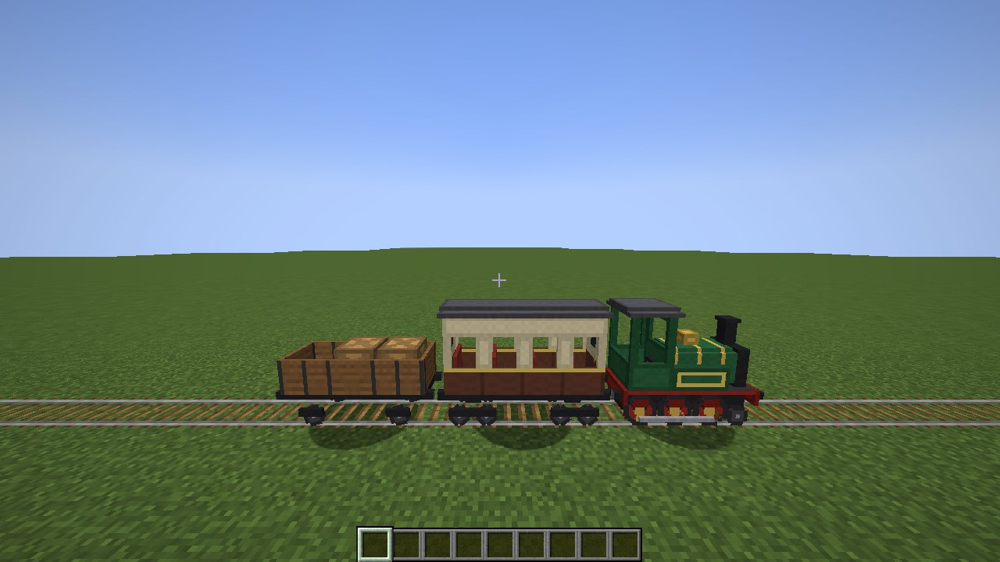
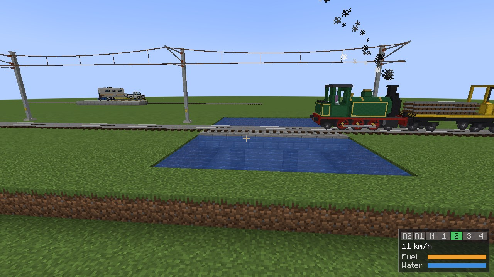
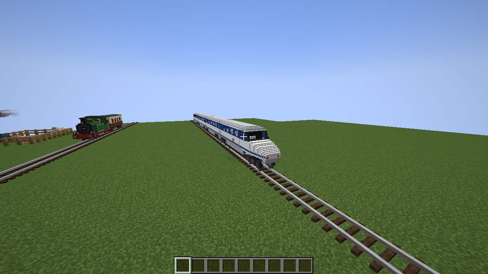
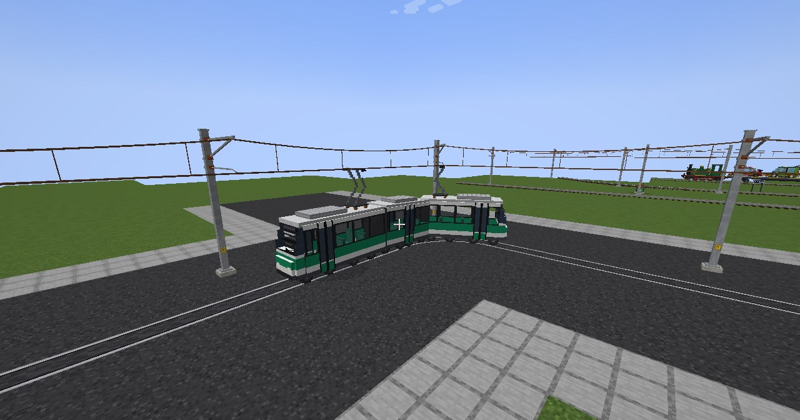
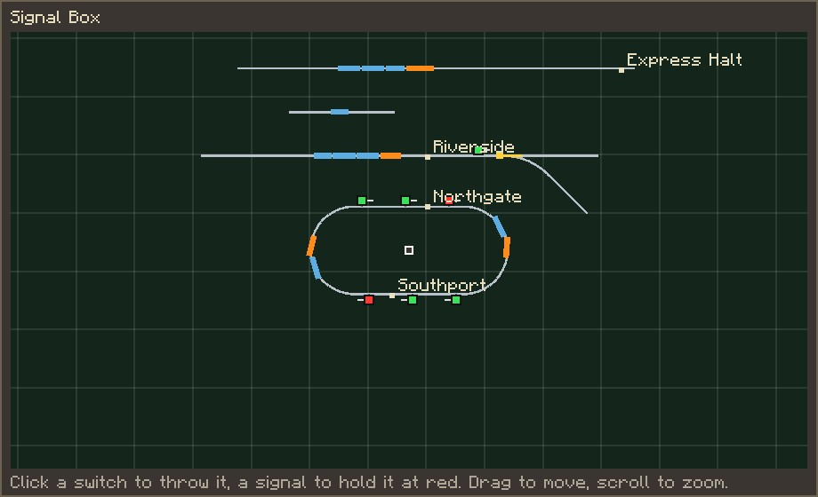
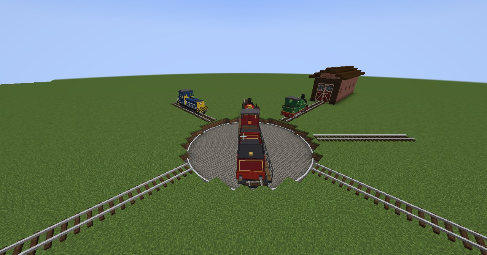

# Reiko's Train Mod

**Big trains on their own track, and trams in the street.** Steam, diesel, electric and a 100 km/h Bullet Train, two
blocks wide and three tall, on bogies that swing round the curves. Build the railway, signal it, and drive the trains
yourself or give them a timetable and let them run it.

## Build a railway

- **Train Track**, separate from minecart rails. Lay it block by block, or draw curves, ramps, S-bends and junctions by
  clicking from one track block to where the line should go, with a preview before you build.
- **Street Track** set into the road, level with it, so cars and people cross it.
- **The Track-Laying Wagon** lays a whole line for you as you drive. It follows the ground at gentle slopes, digs
  cuttings and tunnels through hills, fills dips, builds bridges on piers over rivers, and puts up overhead wires if
  you load them.

## Drive the trains

- **Tank engine** and **express with its tender** (coal and water), a **diesel** on BuildCraft Reborn's fuel, a
  box-cab **electric**, and the **Bullet Train**, with a driving car at each end.
- **Trams**: a vintage single-car tram with its trolley pole, and a three-section low-floor tram that bends round
  street corners. They keep to street rules, and stop for traffic lights from Reiko's Car Mod.
- **Coaches and wagons**: passenger coaches, 108-slot freight wagons, tank wagons for any fluid, livestock wagons, car
  transporters, and a guard's van. Couple as many engines as you like, anywhere in the train.
- Throttle, brake, whistle, and left or right at every junction. The cab gauges show the next signal, switch,
  station and speed limit.

## Signal it and run it

- **Signals** with two, three and four aspects, so fast trains get warning in time.
- A **Signal Box** with a live map of the line: throw switches, hold signals and set routes from it.
- **Switch stands**, **speed limit signs**, **level crossings** and **track sensors**, all working with redstone.
- **Stations and timetables**: trains run between the stations by themselves, leaving wagons at some and picking
  them up at others.

## Freight and depots

- **Wagon Loaders** fill and empty a train's wagons from the chests or tanks beside them, with filters, so a
  timetabled train can carry iron, oil or sheep from one station to another on its own.
- **Water towers**, **charging points** and **overhead wires** to keep engines going. **Engine sheds** that open for
  the trains and top them up inside. **Turntables** to turn engines round, which timetabled trains work themselves.

## The Railway Handbook

With Patchouli installed, every player gets the **Railway Handbook**: a guide in the game to every part of the mod,
with every recipe, the trains turning on stands, and pictures. With JEI installed, every item has an information
page, and there are pages for what each locomotive runs on.

## Requirements

- Minecraft **1.21.1**, NeoForge **21.1.265** or newer
- **BuildCraft Reborn 2.1.0** or newer (required: the diesel runs on its fuel and the electrics on its power)

Optional:

- **Reiko's Car Mod 1.39+**: car transporters carry its cars and their trailers
- **Xaero's Minimap** and **Xaero's World Map**: every train shows on the map, and on the world map you can click
  one to see what it's doing
- **Patchouli**: the Railway Handbook
- **JEI**: information and fuel pages

Install the mod on both the server and every player's game, the same version on each.

## Links

- Source, full guide and changelog: https://github.com/Reiko45/Reiko-s-Train-Mod
- Bugs and ideas: https://github.com/Reiko45/Reiko-s-Train-Mod/issues

Licensed under the GPL-3.0.
